<h1 align="center">Lynx</h1>

<p align="center">
  <a href="LICENSE"></a>
  <a href="https://www.python.org/"></a>
  <a href="pyproject.toml"></a>
  <a href="https://docs.pydantic.dev/"></a>
  <a href="https://github.com/Robusr/Lynx/actions/workflows/ci.yml"></a>
  <a href="vscode-extension/"></a>
  <a href="docs/architecture.md"></a>
</p>

<p align="center">
  <a href="README.md">English</a> |
  <a href="README.zh-CN.md">简体中文</a> |
  <a href="README.fr.md"><strong>Français</strong></a>
</p>

<p align="center">
  <em>SDK de fusion de perception indépendant du matériel pour véhicules autonomes
  à faible vitesse en sites clos : usines, ports, campus et parcs.<br />
  Un SDK, trois backends d'inférence, une sortie standardisée.</em>
</p>

<p align="center">
  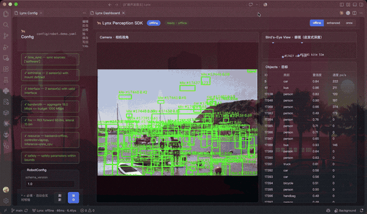
  <br />
  <sub>Démo en direct : superposition caméra, vue du dessus, objets suivis et bascule de backend à chaud.</sub>
</p>

> **L'anglais est la langue de référence.** Les éditions en chinois simplifié et en
> français sont maintenues au mieux et peuvent être en retard sur la source anglaise.

Ce dépôt est un **squelette fonctionnel** : une tranche verticale traversant chaque
couche du produit, conçue pour être durcie vers le SDK de production.

## Sommaire

- [Vue d'ensemble](#vue-densemble)
- [Aperçu](#aperçu)
- [Guide visuel](#guide-visuel)
- [Fonctionnalités](#fonctionnalités)
- [Architecture](#architecture)
- [Démarrage rapide](#démarrage-rapide)
- [Configuration](#configuration)
- [Modèle de données](#modèle-de-données)
- [Backends](#backends)
- [Couche d'abstraction matérielle](#couche-dabstraction-matérielle)
- [Fusion caméra-LiDAR](#fusion-caméra-lidar)
- [Suivi](#suivi)
- [Porte de validation](#porte-de-validation)
- [Télémétrie](#télémétrie)
- [Serveur de démonstration](#serveur-de-démonstration)
- [Extension VS Code](#extension-vs-code)
- [Développement](#développement)
- [Feuille de route](#feuille-de-route)
- [Documentation](#documentation)
- [Licence](#licence)

## Vue d'ensemble

Lynx transforme des images de capteurs brutes en une `PerceptionFrame` standardisée :
objets détectés et suivis, plus panneaux de signalisation, derrière une interface de
plugins indépendante du matériel. Le remplacement d'un capteur, d'un calculateur
embarqué ou d'un transport middleware ne modifie pas le pipeline principal. Un plugin
d'adaptation est ajouté ou remplacé.

| Pilier | Signification |
|---|---|
| **Source unique de vérité** | Un manifeste, `config/robot.demo.yaml`, pilote le schéma JSON, le formulaire de configuration, le validateur préalable et le comportement à l'exécution. |
| **Interfaces indépendantes du matériel** | Les plugins capteur, inférence et middleware partagent des contrats stables. La démo fournit des implémentations replay, YOLO, ONNX et NDJSON. |
| **Sécurité de déploiement** | Sept contrôles sémantiques préalables bloquent les manifestes dangereux. Les dépassements de latence à l'exécution sont marqués sur chaque image. |
| **Sortie standardisée** | `PerceptionFrame` transporte la version du schéma, les boîtes 2D/3D, les pistes, les panneaux, la provenance, les avertissements et la télémétrie. |
| **Observabilité par défaut** | Les métriques en processus exposent les centiles de latence, le débit, les sources, les images abandonnées et les violations de latence. |

## Aperçu

| Question | Réponse |
|---|---|
| **Quelle est l'entrée ?** | Des objets `FrameBatch` alignés dans le temps, fournis par un adaptateur capteur. La démo rejoue des images caméra enregistrées et synthétise le LiDAR pour la fusion. |
| **Quelle est la sortie ?** | Une `PerceptionFrame` prête pour JSON, publiée vers un callback, un `IMiddlewareAdapter` et `Metrics`. |
| **Qui exécute l'inférence ?** | `offline` (YOLO11s), `enhanced` (YOLO11x plus ré-inférence ROI) ou `onnx` (ONNX Runtime avec fournisseurs d'exécution interchangeables). |
| **Que fusionne-t-on ?** | Les détections 2D caméra et les boîtes 3D LiDAR sont associées par IoU 2D après projection. |
| **Que valide-t-on ?** | La synchronisation temporelle, les extrinsèques et fichiers de calibration, le contrat d'interface, la bande passante, le champ de vision, le budget de calcul et les limites de sécurité. |
| **Que montre la démo ?** | Un serveur FastAPI, un tableau de bord sur une seule page et une extension VS Code pilotée par schéma. |

### Instantané des capacités

| Domaine | Capacité | État |
|---|---|---|
| Contrat | `PerceptionFrame`, énumérations, boîtes 2D/3D, avertissements, version de schéma | ✅ Implémenté |
| Configuration | Manifeste Pydantic, sous-modèles typés, bornes, unicité, résolution des chemins | ✅ Implémenté |
| Entrée | Interface capteur en mode pull, adaptateur replay, chemins relatifs au manifeste | ✅ Implémenté |
| Inférence | Offline, enhanced, ONNX Runtime, repli de fournisseur d'exécution | ✅ Implémenté |
| Fusion | LiDAR synthétique, fusion tardive caméra-LiDAR | ✅ Implémenté, niveau démo |
| Suivi | SORT-lite par classe, seuil 3D, double unité de vitesse | ✅ Implémenté, niveau démo |
| Validation | Sept contrôles préalables, acceptation explicite des avertissements, vérification des fichiers de calibration | ✅ Implémenté |
| Opérations | Métriques, bascule de backend à chaud, NDJSON, FastAPI, VS Code | ✅ Implémenté |
| Durcissement production | Fusion multi-capteurs réelle, CalibStore, ROS 2/DDS, ByteTrack | 🚧 Feuille de route |

## Guide visuel

| Schéma | Question à laquelle il répond |
|---|---|
| [Flux d'exécution](#flux-dexécution) | Comment une image traverse-t-elle le SDK ? |
| [Un cycle de perception](#un-cycle-de-perception) | Quel composant appelle quel autre, et dans quel ordre ? |
| [Dépendances entre modules](#dépendances-entre-modules) | Comment les modules du SDK sont-ils reliés ? |
| [Source unique de configuration](#configuration) | Que génère le manifeste ? |
| [Modèle de données](#modèle-de-données) | Que contient une `PerceptionFrame` ? |
| [Sélection du backend](#backends) | Quel backend et quel fournisseur d'exécution sont choisis ? |
| [Interfaces HAL](#couche-dabstraction-matérielle) | Que peut-on brancher ? |
| [Fusion](#fusion-caméra-lidar) | Comment les détections caméra et LiDAR sont-elles associées ? |
| [Cycle de vie d'une piste](#suivi) | Quand une piste est-elle créée, perdue ou supprimée ? |
| [Porte de validation](#porte-de-validation) | Qu'est-ce qui bloque le démarrage ? |
| [Télémétrie](#télémétrie) | Que mesure-t-on à l'exécution ? |
| [Diffusion du serveur](#serveur-de-démonstration) | Comment le tableau de bord reçoit-il les images ? |
| [Câblage de l'extension](#extension-vs-code) | Comment VS Code parle-t-il au SDK ? |
| [CI](#développement) | Que s'exécute à chaque push ? |

## Fonctionnalités

| Capacité | Implémentation | Importance |
|---|---|---|
| **HAL indépendante du matériel** | `ISensorAdapter`, `IInferenceBackend`, `IMiddlewareAdapter` et registres | Le nouveau matériel arrive sous forme de plugin, sans bifurcation du pipeline. |
| **Source unique de vérité** | Modèle Pydantic `sdk/config.py` | Schéma, formulaire, validateur et exécution restent cohérents. |
| **Porte de validation préalable** | Sept contrôles dans `sdk/validate.py` | Un déploiement dangereux échoue avant le traitement de la première image. |
| **Trois backends** | Offline, enhanced, ONNX Runtime | Arbitrer entre précision, latence et portabilité matérielle sans changer les appelants. |
| **Sortie standardisée** | `PerceptionFrame` avec énumérations et champs dérivés | Les consommateurs codent contre un seul contrat. |
| **Fusion tardive** | Association par IoU 2D projeté | Classe caméra et géométrie LiDAR sur les objets appariés. |
| **Télémétrie d'exécution** | Centiles de latence, FPS, sources, abandons, violations | La démo montre la santé du système, pas seulement des boîtes. |
| **Deux hôtes** | Tableau de bord FastAPI et extension VS Code | Inspecter le même SDK depuis un navigateur ou l'éditeur. |

## Architecture

<p align="center">
  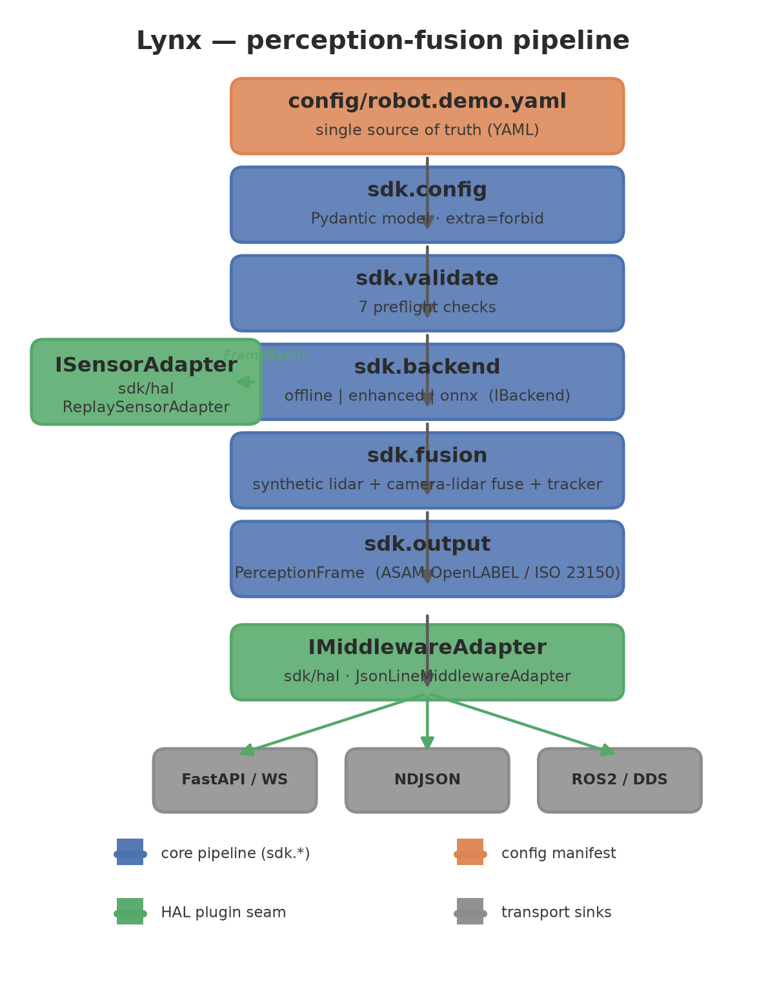
</p>

Les deux extrémités du pipeline sont des interfaces de plugins :

- `ISensorAdapter` dans `sdk/hal/sensor.py` alimente le pipeline avec des objets
  `FrameBatch` alignés dans le temps. La démo fournit `ReplaySensorAdapter`, qui
  rejoue des images enregistrées comme un pilote caméra réel.
- `IMiddlewareAdapter` dans `sdk/hal/middleware.py` publie chaque `PerceptionFrame`
  vers n'importe quel transport. La démo fournit `JsonLineMiddlewareAdapter`, qui
  écrit du NDJSON.

### Flux d'exécution

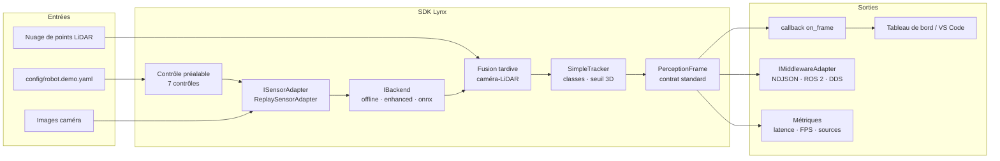

### Un cycle de perception

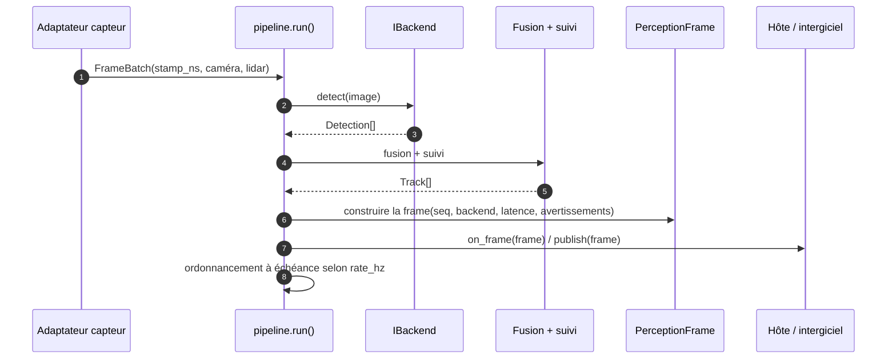

### Dépendances entre modules

<p align="center">
  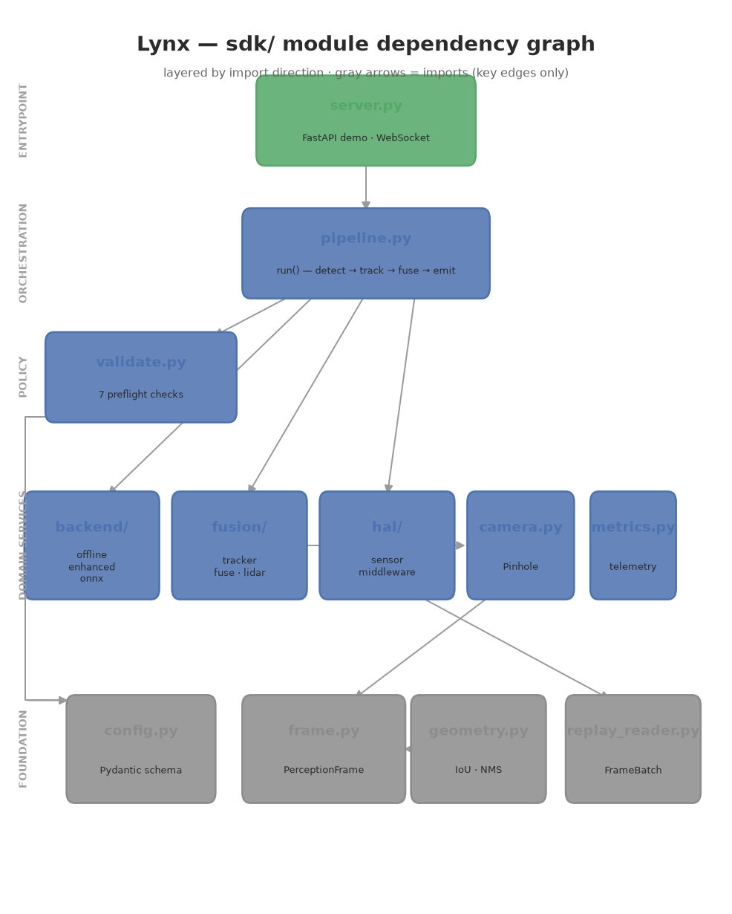
</p>

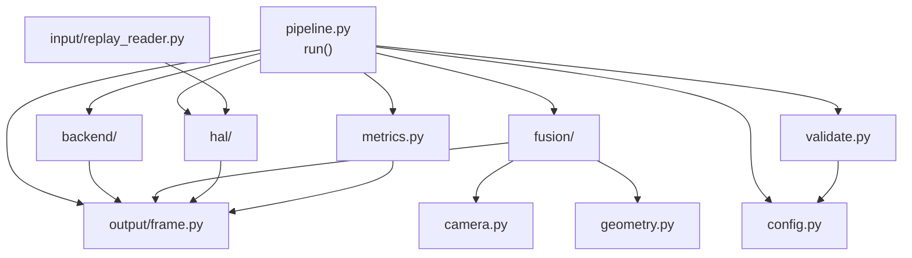

Les imports partent de `pipeline.py` (`run()`) vers `backend/`, `fusion/` et `hal/`,
tandis que `validate.py` lit le manifeste avant le démarrage des services d'exécution.
Deux feuilles sont importées par presque tous les modules : `output/frame.py`, le
contrat produit, et `config.py`, le schéma Pydantic. `input/replay_reader.py` fournit
la source `FrameBatch` de la démo.

Une vue textuelle, le flux d'exécution et le contrat des points d'extension se trouvent
dans [docs/architecture.md](docs/architecture.md).

### Organisation du dépôt

| Chemin | Responsabilité |
|---|---|
| `config/robot.demo.yaml` | Manifeste, source unique de vérité |
| `sdk/config.py` | Schéma Pydantic, chargeur, résolution des chemins |
| `sdk/validate.py` | Sept contrôles préalables et rapport JSON |
| `sdk/output/frame.py` | `PerceptionFrame` et le modèle de données produit |
| `sdk/backend/` | Interface backend, offline, enhanced, ONNX, registre |
| `sdk/input/replay_reader.py` | `FrameBatch` et source replay |
| `sdk/hal/` | Interfaces capteur et middleware, adaptateurs de démonstration |
| `sdk/fusion/` | Suivi, fusion tardive caméra-LiDAR, LiDAR synthétique |
| `sdk/camera.py`, `sdk/geometry.py` | Modèle sténopé, IoU, NMS, fusion de boîtes |
| `sdk/metrics.py` | Télémétrie en processus |
| `sdk/pipeline.py` | `run()` et ordonnancement à échéance |
| `server.py`, `dashboard/` | Démo FastAPI et tableau de bord monopage |
| `vscode-extension/` | Formulaire de configuration et webview tableau de bord |
| `scripts/` | Run, smoke, benchmark, I/O de configuration, génération de schémas et d'assets |
| `docs/` | Architecture, schémas, JSON Schema généré, captures d'écran |
| `tests/` | Tests de contrat, configuration, pipeline, fusion, suivi, ONNX, registre |

## Démarrage rapide

Nécessite Python 3.11+. Les backends ML recommandent Python 3.11 ou 3.12.

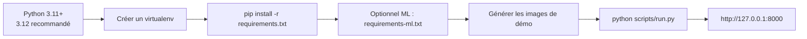

```bash
# 1. virtualenv
python3.12 -m venv .venv && source .venv/bin/activate

# 2. dépendances de base : modèle de données, configuration, validation, serveur
pip install -r requirements.txt

# 3. dépendances ML optionnelles pour l'inférence réelle
pip install -r requirements-ml.txt

# 4. images de démonstration synthétiques, sans caméra
python scripts/make_demo_data.py 240 data/frames

# 5. lancer la démo
python scripts/run.py
# -> http://127.0.0.1:8000
```

Test de fumée sans interface, sans serveur ni UI :

```bash
python scripts/smoke.py config/robot.demo.yaml 5          # lisible par un humain
python scripts/smoke.py config/robot.demo.yaml 5 --jsonl  # NDJSON pur sur stdout
```

Lancer la suite de tests complète :

```bash
python -m pytest tests/
ruff check sdk scripts tests server.py
mypy sdk
```

## Configuration

`config/robot.demo.yaml` est le seul fichier de déploiement écrit à la main. Ses clés
correspondent 1:1 à `sdk/config.py`, et il est la source du schéma JSON qui alimente
l'IntelliSense de l'éditeur et le formulaire de configuration VS Code.

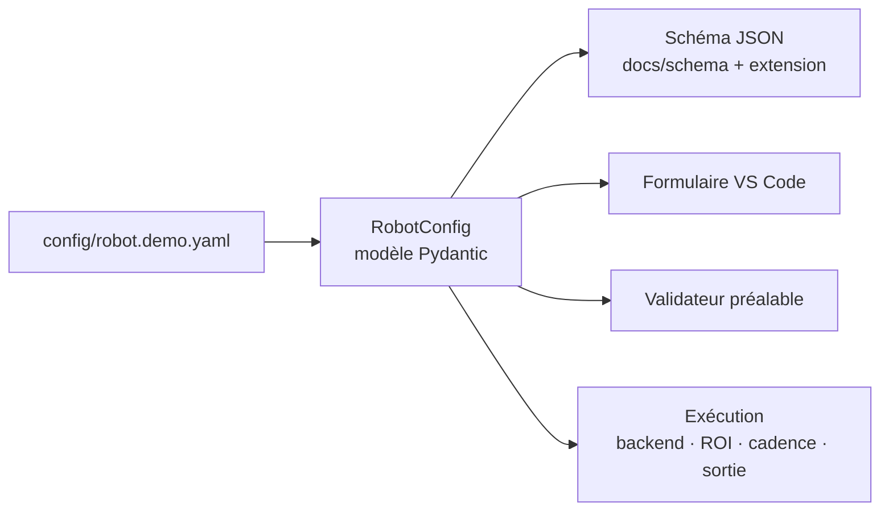

```yaml
vehicle:                    # modèle cinématique + encombrement
  name: "demo_factory_truck"
  type: "ackermann"         # diff_drive | ackermann | skid_steer | omni
  max_speed_ms: 5.0
  wheelbase_m: 1.8
  track_width_m: 1.4
  dimensions: { l: 2.4, w: 1.3, h: 1.9 }

domain_controller:          # calculateur embarqué cible
  vendor: "nvidia"
  model: "laptop"           # laptop | jetson_orin_nano | rk3588
  compute_tops: 0
  inference_backend: "onnx_cpu"
  os: "ubuntu_22.04"
  middleware: "custom"      # ros2_humble | ros2_iron | dds_rti | some_ip | custom

sensors:                    # une entrée par capteur, noms uniques
  - name: "front_cam"
    type: "camera"
    interface: "usb"        # gige | ethernet | can | usb
    topic: "cam/front"
    mount: { x: 0.0, y: 0.0, z: 1.4, roll: 0, pitch: 0, yaw: 0 }
    fps: 20
    sync_source: "software"

perception:
  backend: "offline"        # offline | enhanced | onnx
  conf: 0.4                 # 0.0 .. 1.0
  modules: [detection, tracking, traffic_sign]  # detection obligatoire
  roi: { forward_m: 60, lateral_m: 15 }
  small_target_enhance: true

calibration:                # les fichiers déclarés sont vérifiés au pré-vol
  camera_intrinsics: null
  extrinsics: null
  lidar_camera_extrinsic: null
  time_offset_ms: {}

safety:                     # @ai-lock — lecture seule via les outils
  min_braking_distance_m: 1.0
  min_obstacle_height_m: 0.05
  max_detection_latency_ms: 100
  redundant_fov_required: true

data:                       # relatif à ce manifeste dans config/
  frames_dir: "../data/frames"
  index_path: "../data/index.csv"
```

| Section | Contrôle | Consommé par |
|---|---|---|
| `vehicle` | Cinématique, vitesse maximale, encombrement | Contrôles de sécurité, géométrie |
| `domain_controller` | Fournisseur, carte, TOPS, fournisseur d'exécution, middleware | Sélection du backend, contrôle de ressources, fabrique middleware |
| `sensors` | Modalité, interface, montage, cadence, source de synchronisation | Pré-vol, sélection d'adaptateur, fusion |
| `perception` | Backend, confiance, modules, ROI, passe petits objets | Pipeline, fabriques de backends |
| `output` | Identifiant de frame et cadence de boucle | `PerceptionFrame`, ordonnancement à échéance |
| `calibration` | Intrinsèques, extrinsèques, décalages temporels | Vérification préalable des fichiers ; `CalibStore` est un jalon ultérieur |
| `safety` | Freinage, hauteur d'obstacle, plafond de latence, FOV redondant | Pré-vol et avertissements par image |
| `data` | Images et index de rejeu | `ReplaySensorAdapter` |

Les chemins relatifs sont résolus par rapport au répertoire du manifeste, ce qui permet
de lancer le SDK depuis n'importe quel répertoire de travail.

Conventions d'annotation IA dans le manifeste :

- `@ai-lock` marque les blocs en lecture seule, comme `safety`, que les outils ne
  doivent pas réécrire silencieusement.
- `@ai-extend` marque les attributs personnalisés extensibles.
- `@ai-telemetry` marque les champs qui alimentent le flux de télémétrie.

## Modèle de données

Le contrat produit est `PerceptionFrame` dans `sdk/output/frame.py`, exporté en schéma
JSON dans `docs/schema/perception_frame.schema.json`.

<p align="center">
  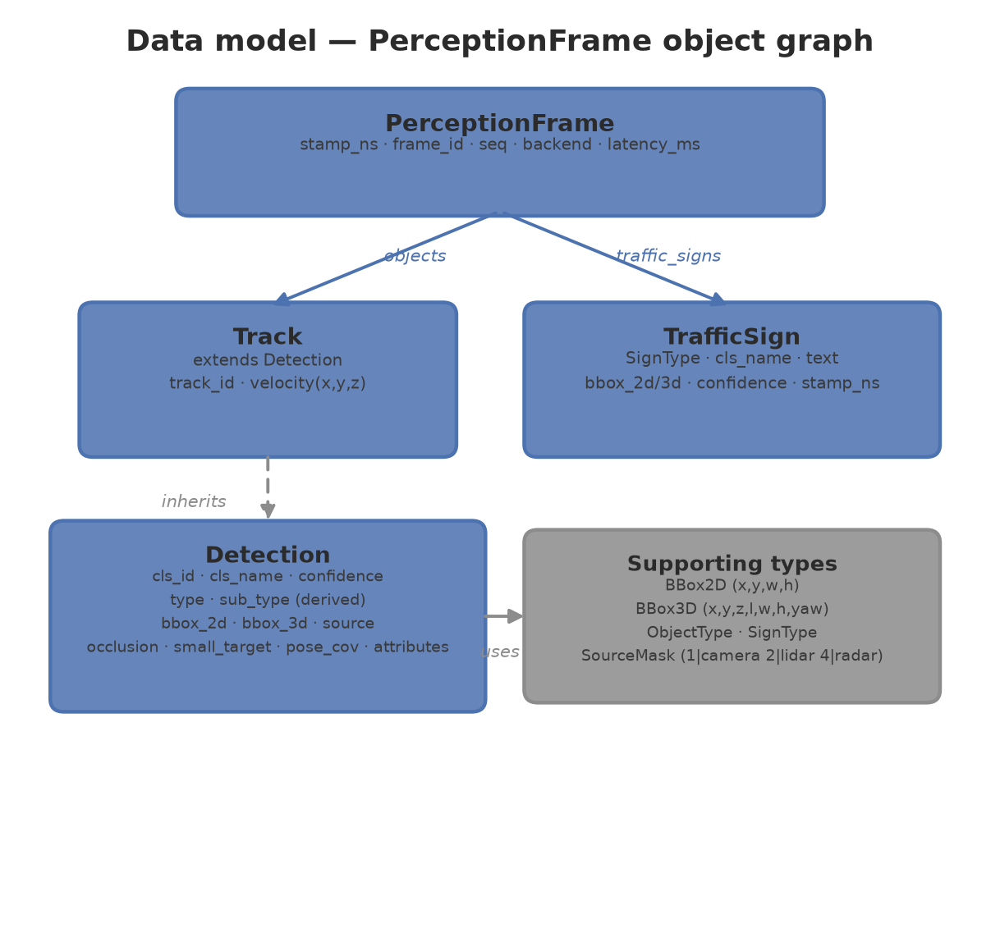
</p>

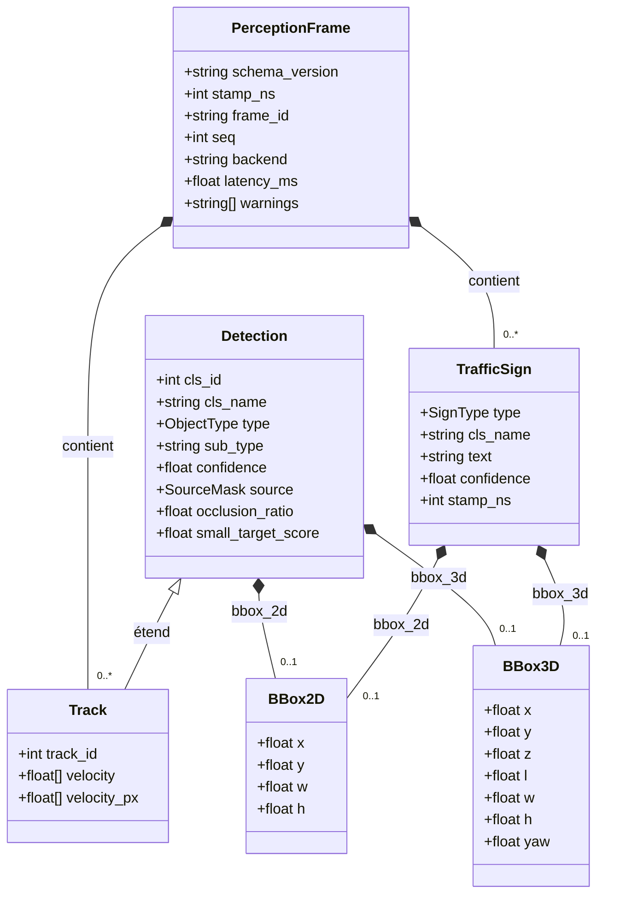

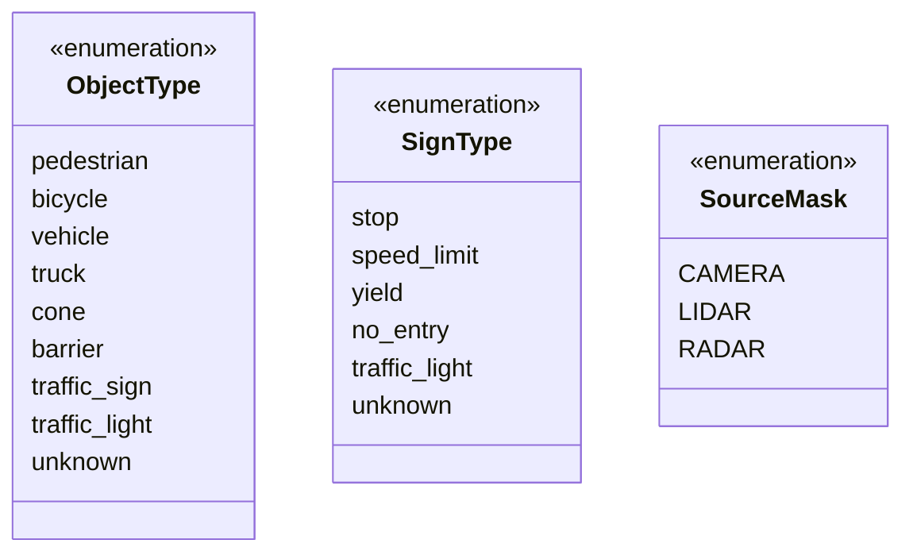

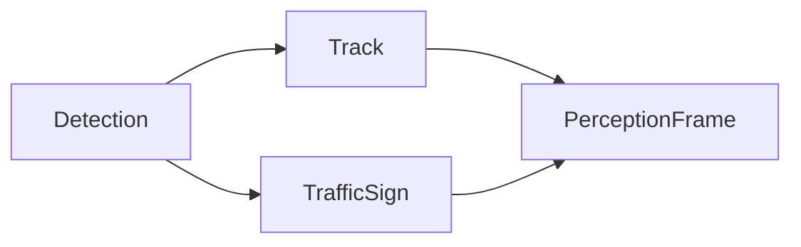

| Type | Description |
|---|---|
| `PerceptionFrame` | `schema_version`, `stamp_ns`, `frame_id`, `seq`, `backend`, `objects`, `traffic_signs`, `latency_ms`, `warnings` |
| `Track` | `Detection` plus `track_id`, `velocity` 3D en m/s et `velocity_px` en px/s |
| `TrafficSign` | `type`, `cls_name`, `text`, `bbox_2d/3d`, `confidence`, `stamp_ns` |
| `Detection` | `cls_id`, `cls_name`, `type`, `sub_type`, `bbox_2d/3d`, `confidence`, `source`, `occlusion_ratio`, `small_target_score`, `pose_covariance`, `attributes` |
| `BBox2D` / `BBox3D` | Boîtes plan image `(x, y, w, h)` et repère véhicule `(x, y, z, l, w, h, yaw)` |

Énumérations :

- `ObjectType` : `pedestrian`, `bicycle`, `vehicle`, `truck`, `cone`, `barrier`,
  `traffic_sign`, `traffic_light`, `unknown`.
- `SignType` : `stop`, `speed_limit`, `yield`, `no_entry`, `traffic_light`,
  `unknown`.
- `SourceMask` (`IntFlag`) : `CAMERA=1`, `LIDAR=2`, `RADAR=4`. La fusion est un OU
  binaire, par exemple `CAMERA + LIDAR = 3`. `source_label()` produit un libellé.

Les champs dérivés sont remplis par des validateurs Pydantic : `type` est dérivé de
`cls_name`, par exemple `person` devient `pedestrian`, et `sub_type` porte la classe
fine. `pose_covariance` est une liste 6x6 en ordre ligne-major, vide si inconnue.
`attributes` contient les données personnalisées `@ai-extend`.

## Backends

Tous les backends implémentent la même interface `IBackend` : `init`, `detect`, `info`
et `release`. Le choix se fait avec `perception.backend`.

<p align="center">
  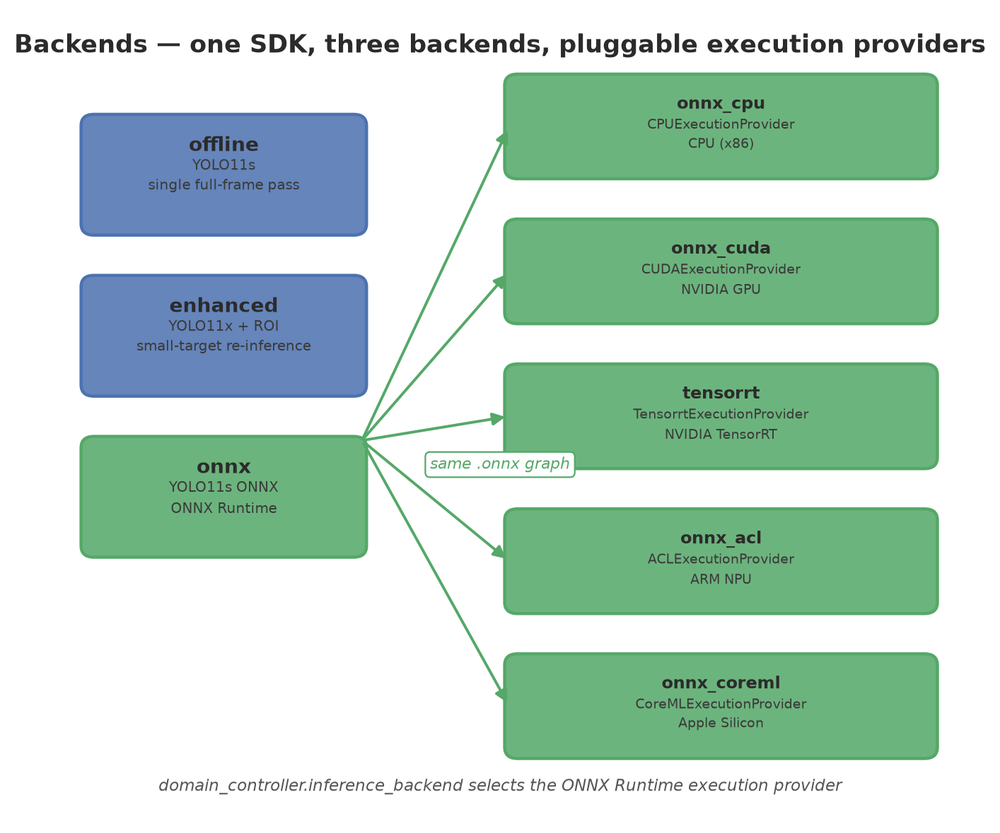
</p>

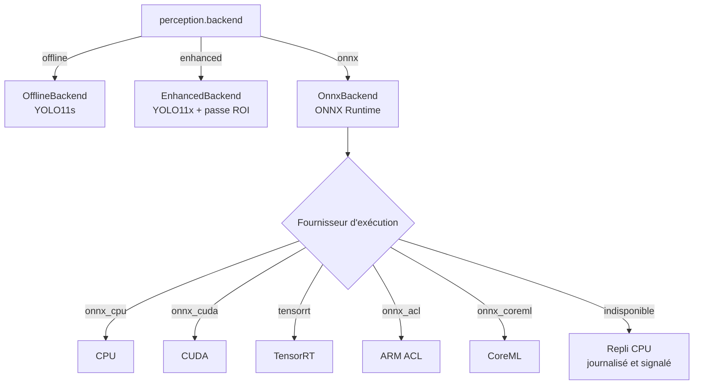

| Backend | Modèle | Idéal pour | Remarques |
|---|---|---|---|
| `offline` | YOLO11s | Flotte par défaut, calculateurs CPU | Passe plein cadre unique, déterministe et léger |
| `enhanced` | YOLO11x + YOLO11s ROI | Validation GPU ou portable, petits objets lointains | Seconde passe sur la bande supérieure ; le modèle ROI se charge à la demande |
| `onnx` | YOLO11s ONNX | Portabilité entre CPU et accélérateurs | Fournisseur choisi via `domain_controller.inference_backend` |

Le backend ONNX est la voie indépendante du matériel : le même graphe `.onnx` tourne
sur CPU, CUDA, TensorRT, ARM ACL ou CoreML sans changer le code du SDK. Si le
fournisseur demandé est indisponible, le backend se replie sur CPU et expose le
fournisseur réel dans `BackendInfo.extra`.

## Couche d'abstraction matérielle

`sdk/hal/` définit les interfaces de plugins qui rendent le SDK indépendant du matériel.

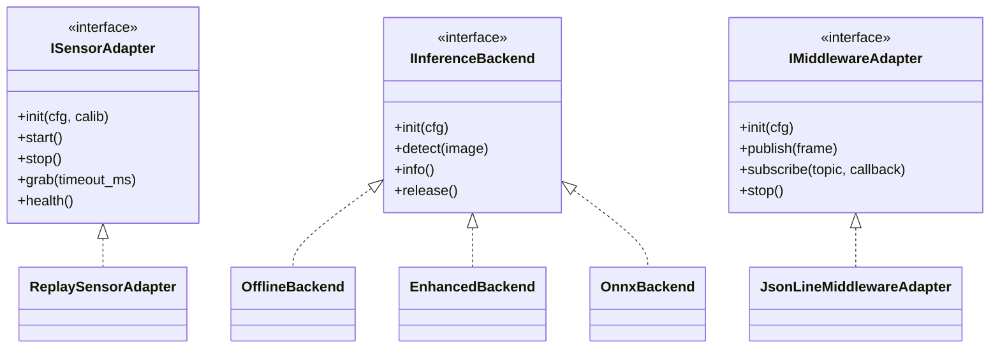

| Interface | Méthodes | Implémentation de démonstration |
|---|---|---|
| `ISensorAdapter` | `init`, `start`, `stop`, `grab`, `health` | `ReplaySensorAdapter` rejoue des images en mode pull |
| `IInferenceBackend` | `init`, `detect`, `info`, `release` | Backends offline, enhanced et ONNX |
| `IMiddlewareAdapter` | `init`, `publish`, `subscribe`, `stop` | `JsonLineMiddlewareAdapter` publie du NDJSON |

Chaque interface possède un registre, donc les implémentations tierces ne modifient pas
le cœur :

```python
from sdk.backend import register_backend

register_backend("my_backend", lambda cfg: MyBackend(cfg))
```

Une version de production ajoute un adaptateur par capteur physique et fusionne leurs
flux dans un `FrameBatch`. La démo utilise un seul adaptateur replay et synthétise le
LiDAR pour la voie de fusion.

## Fusion caméra-LiDAR

La fusion tardive associe les détections 2D caméra aux boîtes 3D LiDAR après projection
des boîtes par le modèle sténopé. Les objets appariés conservent la classe caméra et la
géométrie LiDAR.

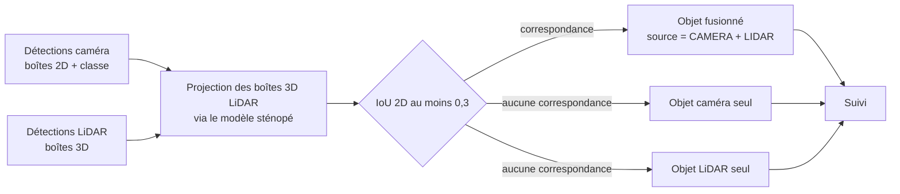

La démo fournit `sdk/fusion/lidar.py`, qui rétro-projette les boîtes caméra en boîtes
3D plausibles pour exécuter la fusion sans LiDAR réel. Le code d'association dans
`sdk/fusion/fuse.py` est le même que celui qu'alimenterait un front-end de nuage de
points en production.

## Suivi

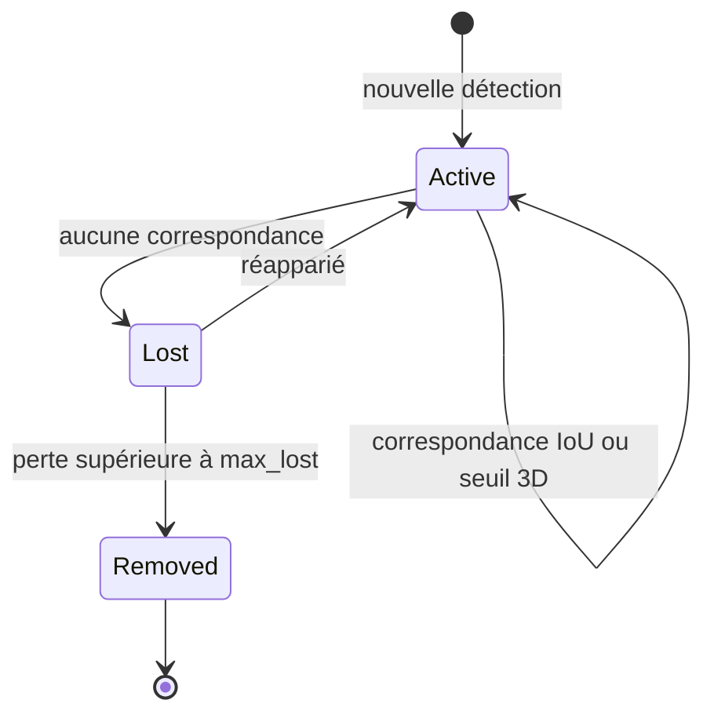

`SimpleTracker` est un traqueur SORT-lite lisible. Il filtre les associations par
classe, utilise d'abord l'IoU 2D puis un seuil de distance 3D pour les détections
LiDAR seules, et émet à la fois une vitesse dans le repère véhicule en m/s et une
vitesse plan image en px/s. La voie d'évolution production est ByteTrack ou un
appariement hongrois avec filtre de Kalman.

## Porte de validation

`sdk/validate.py` exécute sept contrôles sémantiques avant le démarrage du pipeline.
`to_report()` produit un rapport JSON, et
`scripts/validate_json.py --out preflight_report.json` l'écrit sur disque.

<p align="center">
  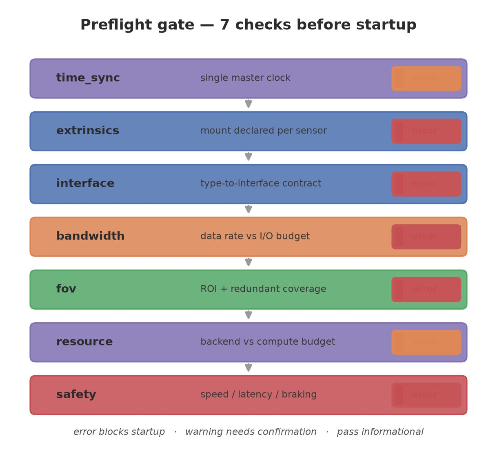
</p>

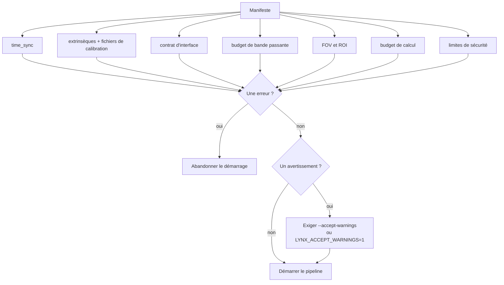

| Contrôle | Objet |
|---|---|
| `time_sync` | Horloge maître unique entre les capteurs |
| `extrinsics` | Chaque capteur déclare un `mount` ; les fichiers de calibration déclarés existent |
| `interface` | Le type de capteur correspond à une interface physique valide |
| `bandwidth` | Le débit agrégé par type reste dans le budget |
| `fov` | La ROI est positive ; redondance avant si requise ; au moins une caméra |
| `resource` | Backend et calculateur restent dans le budget de calcul |
| `safety` | Vitesse, latence et distance de freinage sont positives |

Les erreurs bloquent le démarrage. Les avertissements nécessitent un accord explicite :
`python scripts/run.py --accept-warnings` ou `LYNX_ACCEPT_WARNINGS=1`. Une latence
d'exécution supérieure à `safety.max_detection_latency_ms` ajoute
`detection_latency_exceeded` à `PerceptionFrame.warnings` et incrémente la métrique
`latency_violations`.

## Télémétrie

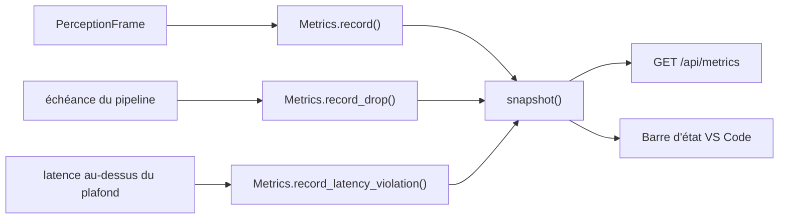

| Métrique | Signification |
|---|---|
| `frames`, `fps`, `uptime_s` | Débit et vivacité |
| `latency_ms.last/avg/p95/max` | Latence de détection, centiles nearest-rank |
| `objects.last`, `objects.sources` | Nombre d'objets par caméra, LiDAR, radar ou fusion |
| `dropped_frames` | Échéances manquées de plus d'une période |
| `latency_violations` | Images au-dessus de `safety.max_detection_latency_ms` |

## Serveur de démonstration

`server.py` expose une application FastAPI. Le pipeline tourne dans un thread démon,
et un thread de diffusion séparé annote et encode les images JPEG uniquement lorsqu'un
client est connecté.

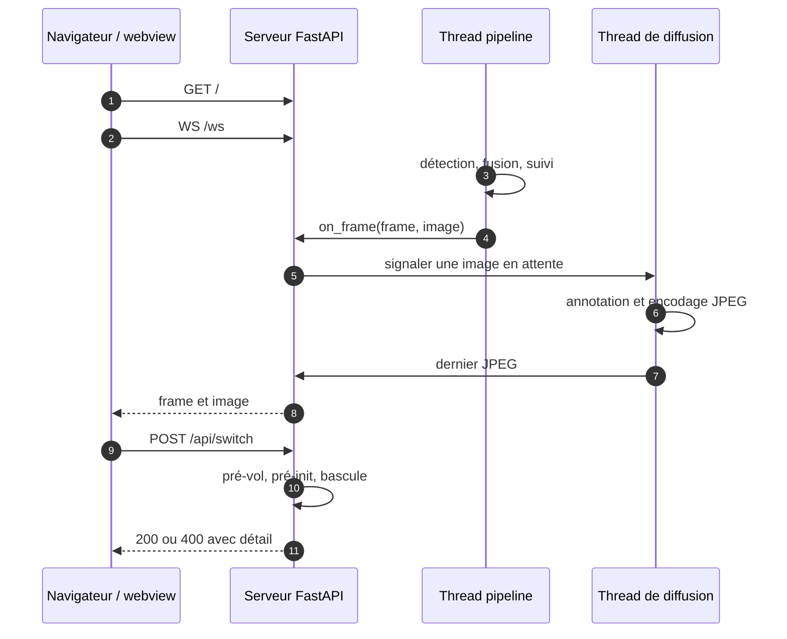

| Endpoint | Description |
|---|---|
| `GET /` | Tableau de bord sur une seule page |
| `WS /ws` | Diffuse `{ frame, image }` ; l'image est un JPEG base64 |
| `GET /api/state` | Backend, vivacité, dernière erreur, plafond de latence |
| `GET /api/metrics` | Télémétrie d'exécution |
| `POST /api/switch` | Bascule `offline`, `enhanced` ou `onnx` à chaud |

La bascule de backend pré-initialise le nouveau backend avant d'arrêter l'ancien. Si
l'initialisation échoue, l'ancien pipeline continue et l'endpoint renvoie HTTP 400 avec
la raison. Le serveur active CORS pour les webviews locales afin que le tableau de bord
VS Code puisse appeler `/api/switch`.

## Extension VS Code

<p align="center">
  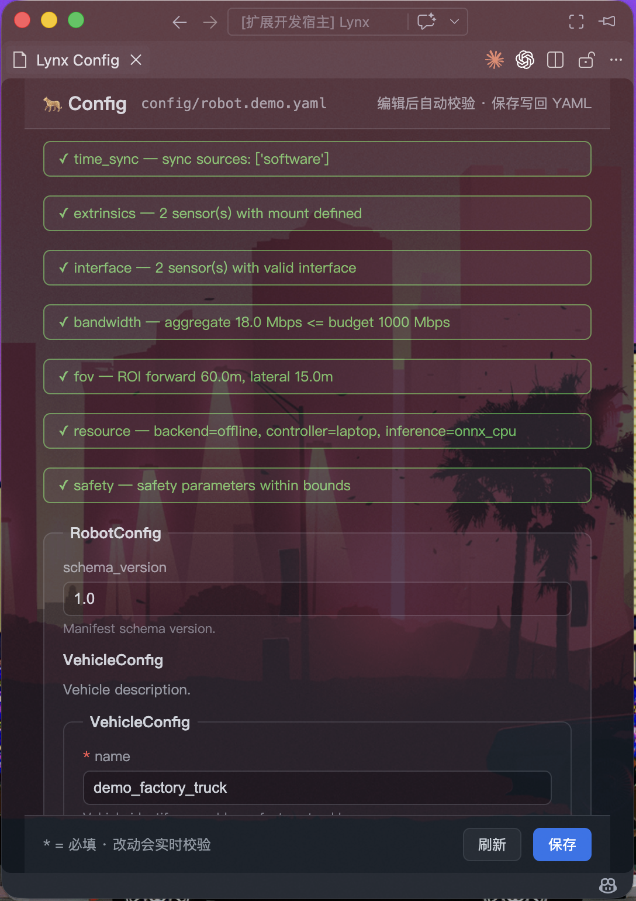
  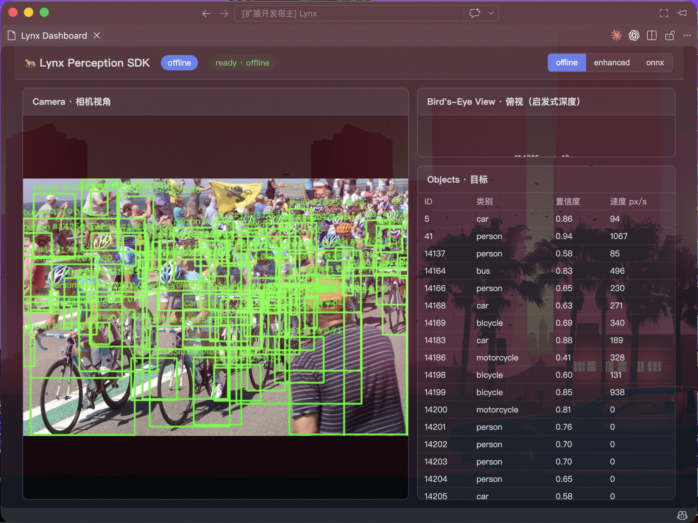
</p>

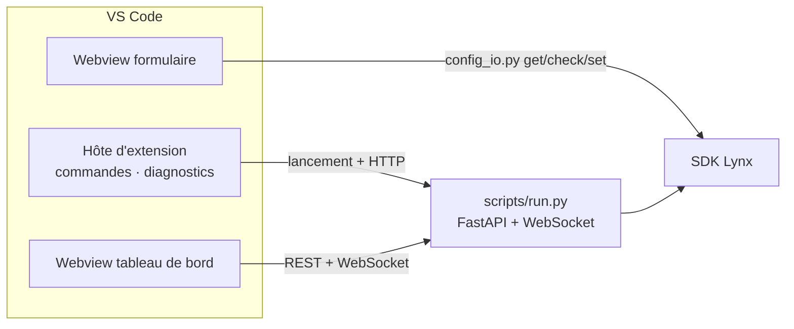

| Fonction | Commande | Détail |
|---|---|---|
| Tableau de bord | `Lynx: Show Dashboard` | Superposition caméra, vue du dessus, objets |
| Démarrer / arrêter | `Lynx: Start Demo` / `Lynx: Stop` | Lance ou tue `scripts/run.py` sur un port libre |
| Bascule backend | `Lynx: Switch Backend` | QuickPick offline, enhanced, onnx |
| Formulaire de configuration | `Lynx: Edit Config (Form)` | Formulaire piloté par schéma avec contrôles préalables en direct |
| Validation | `Lynx: Validate Config` | Exécute `validate_json.py` et mappe les résultats en diagnostics |

## Développement

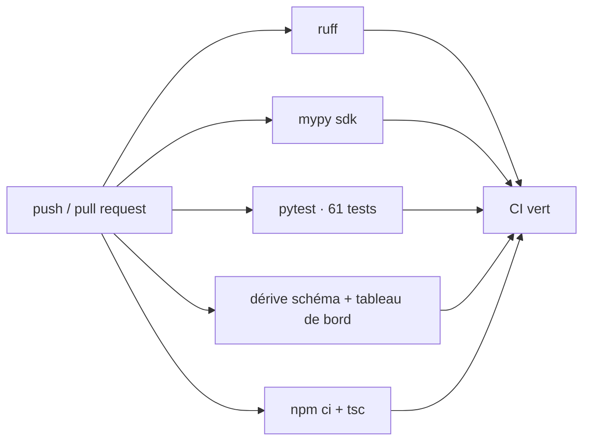

```bash
python scripts/export_schema.py docs/schema    # régénère le schéma JSON + la copie extension
python scripts/export_schema.py --check        # garde anti-dérive CI
python scripts/sync_dashboard.py               # régénère le tableau de bord webview
python scripts/sync_dashboard.py --check       # garde anti-dérive CI
python scripts/validate_json.py config/robot.demo.yaml --out preflight_report.json
python scripts/config_io.py get config/robot.demo.yaml       # config -> JSON
python scripts/config_io.py set config/robot.demo.yaml       # JSON -> config sur stdin
python -m pytest tests/
ruff check sdk scripts tests server.py
mypy sdk
```

| Domaine de test | Ce qu'il prouve |
|---|---|
| `test_frame`, `test_contract` | Schéma de sortie, champs dérivés, versionnage, sérialisation |
| `test_config`, `test_config_io` | Bornes, unicité, résolution de chemins, écritures atomiques préservant les commentaires |
| `test_pipeline` | Tranche verticale, logs stderr, acceptation des avertissements, marquage de latence, filtres de modules |
| `test_fusion`, `test_geometry` | Projection, association, NMS et fusion de boîtes par classe |
| `test_tracker` | Persistance des identifiants, filtrage par classe, vitesses 2D/3D |
| `test_onnx_decode` | Les deux dispositions de sortie ONNX et le mapping letterbox |
| `test_replay_reader`, `test_registry` | Source replay et registres de plugins |

Le SDK s'installe avec `pip install -e .` et les extras `.[ml]`, `.[server]` et
`.[dev]`. `pyproject.toml` est la source unique de packaging. Les messages de commit
suivent Conventional Commits et sont rédigés en anglais.

## Feuille de route

| Jalon | État | Périmètre |
|---|---|---|
| Squelette fonctionnel | ✅ Terminé | Pipeline de bout en bout, serveur de démo, tableau de bord, coquille VS Code |
| Exécution durcie | 🚧 En cours | Bascule sûre de backend, diffuseur, ordonnancement à échéance, gardes anti-dérive |
| Entrée multi-capteurs réelle | Prévu | Un adaptateur par capteur et fusion des flux `FrameBatch` |
| Stockage de calibration | Prévu | Chargement des intrinsèques, extrinsèques et décalages temporels |
| Adaptateurs de transport | Prévu | Implémentations middleware ROS 2, DDS et SOME/IP |
| Suivi de production | Prévu | ByteTrack ou appariement hongrois avec filtrage de Kalman |
| Outillage de déploiement | Prévu | Budgets de calcul mesurés, packaging des modèles, profils de dispositifs |

## Documentation

| Document | Contenu |
|---|---|
| [docs/architecture.md](docs/architecture.md) | Flux d'exécution, couches, points d'extension, jalons |
| [docs/schema/robot_config.schema.json](docs/schema/robot_config.schema.json) | Schéma JSON de configuration généré |
| [docs/schema/perception_frame.schema.json](docs/schema/perception_frame.schema.json) | Schéma JSON de sortie généré |
| [docs/architecture.png](docs/architecture.png) | Vue d'ensemble de l'architecture |
| [docs/dependencies.png](docs/dependencies.png) | Graphe de dépendances des modules |
| [docs/datamodel.png](docs/datamodel.png) | Vue d'ensemble du modèle de données |
| [docs/backends.png](docs/backends.png) | Backends et fournisseurs d'exécution |
| [docs/validation.png](docs/validation.png) | Porte de validation |
| [README.zh-CN.md](README.zh-CN.md) | Traduction en chinois simplifié |
| [README.md](README.md) | Source anglaise de référence |

## Licence

Apache-2.0. Voir [LICENSE](LICENSE).
