<h1 align="center">Lynx</h1>

<p align="center">
  <a href="LICENSE"></a>
  <a href="https://www.python.org/"></a>
  <a href="pyproject.toml"></a>
  <a href="https://docs.pydantic.dev/"></a>
  <a href="https://github.com/Robusr/Lynx/actions/workflows/ci.yml"></a>
  <a href="vscode-extension/"></a>
  <a href="docs/architecture.md"></a>
</p>

<p align="center">
  <a href="README.md"><strong>English</strong></a> |
  <a href="README.zh-CN.md">简体中文</a> |
  <a href="README.fr.md">Français</a>
</p>

<p align="center">
  <em>Hardware-agnostic perception-fusion SDK for low-speed autonomous vehicles in
  enclosed sites: factories, ports, campuses, and parks.<br />
  One SDK, three inference backends, one standardized output.</em>
</p>

<p align="center">
  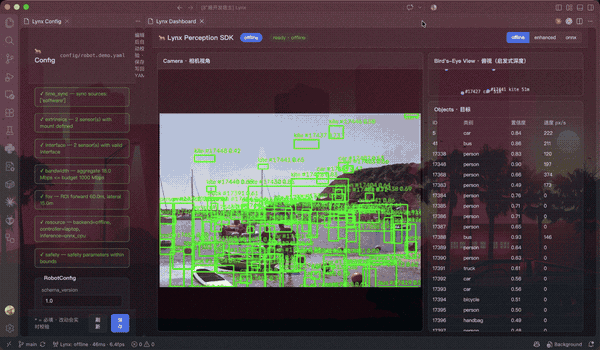
  <br />
  <sub>Live demo: camera overlay, bird's-eye view, tracked objects, and runtime backend switching.</sub>
</p>

> **English is the primary language.** The Simplified Chinese and French editions
> are maintained on a best-effort basis and may lag behind the English source.

This repository is a **walking skeleton**: a vertical slice through every layer of
the product, built to be hardened into the production SDK.

## Table of contents

- [Overview](#overview)
- [At a glance](#at-a-glance)
- [Visual guide](#visual-guide)
- [Features](#features)
- [Architecture](#architecture)
- [Quick start](#quick-start)
- [Configuration](#configuration)
- [Data model](#data-model)
- [Backends](#backends)
- [Hardware abstraction layer](#hardware-abstraction-layer)
- [Camera-LiDAR fusion](#camera-lidar-fusion)
- [Tracking](#tracking)
- [Validation gate](#validation-gate)
- [Telemetry](#telemetry)
- [Demo server](#demo-server)
- [VS Code extension](#vs-code-extension)
- [Development](#development)
- [Roadmap](#roadmap)
- [Documentation](#documentation)
- [License](#license)

## Overview

Lynx turns raw sensor frames into a standardized `PerceptionFrame`: detected and
tracked objects plus traffic signs, behind a hardware-agnostic plugin interface.
Swapping a sensor, a domain controller, or a middleware transport does not change
the core pipeline. You add or replace an adapter plugin.

| Pillar | What it means |
|---|---|
| **Single source of truth** | One manifest, `config/robot.demo.yaml`, drives the JSON Schema, the config form, the preflight validator, and runtime behavior. |
| **Hardware-agnostic seams** | Sensor, inference, and middleware plugins share stable contracts. The demo ships replay, YOLO, ONNX, and NDJSON implementations. |
| **Deployment safety** | Seven semantic preflight checks block unsafe manifests. Runtime latency violations are stamped onto each frame. |
| **Standardized output** | `PerceptionFrame` carries schema version, 2D/3D boxes, tracks, signs, provenance, warnings, and telemetry. |
| **Observable by default** | In-process metrics expose latency percentiles, throughput, source counts, dropped frames, and latency violations. |

## At a glance

| Question | Answer |
|---|---|
| **What is the input?** | Time-aligned `FrameBatch` objects from a sensor adapter. The demo replays recorded camera frames and synthesizes LiDAR for fusion. |
| **What is the output?** | A JSON-ready `PerceptionFrame` published to a callback, an `IMiddlewareAdapter`, and `Metrics`. |
| **What runs inference?** | `offline` (YOLO11s), `enhanced` (YOLO11x plus ROI re-inference), or `onnx` (ONNX Runtime with pluggable execution providers). |
| **What is fused?** | Camera 2D detections and LiDAR 3D boxes are associated by projected 2D IoU. |
| **What is validated?** | Time sync, extrinsics and calibration files, interface contract, bandwidth, FOV, compute budget, and safety bounds. |
| **What is demoed?** | A FastAPI server, a single-page dashboard, and a schema-driven VS Code extension. |

### Capability snapshot

| Area | Capability | Status |
|---|---|---|
| Contract | `PerceptionFrame`, enums, 2D/3D boxes, warnings, schema version | ✅ Implemented |
| Configuration | Pydantic manifest, typed submodels, bounds, uniqueness, path resolution | ✅ Implemented |
| Input | Pull-mode sensor seam, replay adapter, manifest-relative data paths | ✅ Implemented |
| Inference | Offline, enhanced, ONNX Runtime, execution-provider fallback | ✅ Implemented |
| Fusion | Synthetic LiDAR, camera-LiDAR late fusion | ✅ Implemented, demo-grade |
| Tracking | Class-aware SORT-lite, 3D gating, dual velocity units | ✅ Implemented, demo-grade |
| Validation | Seven preflight checks, warning opt-in, calibration file checks | ✅ Implemented |
| Operations | Metrics, runtime backend switching, NDJSON, FastAPI, VS Code | ✅ Implemented |
| Production hardening | Real multi-sensor merge, CalibStore, ROS 2/DDS, ByteTrack | 🚧 Roadmap |

## Visual guide

| Diagram | Question it answers |
|---|---|
| [Runtime flow](#runtime-flow) | How does a frame travel through the SDK? |
| [One perception tick](#one-perception-tick) | Which component calls which, in what order? |
| [Module dependencies](#module-dependencies) | How are the SDK modules connected? |
| [Configuration SSOT](#configuration) | What is generated from the manifest? |
| [Data model](#data-model) | What does a `PerceptionFrame` contain? |
| [Backend selection](#backends) | Which backend and execution provider are chosen? |
| [HAL seams](#hardware-abstraction-layer) | What can be plugged in? |
| [Fusion](#camera-lidar-fusion) | How are camera and LiDAR detections associated? |
| [Track lifecycle](#tracking) | When is a track created, lost, or removed? |
| [Validation gate](#validation-gate) | What blocks startup? |
| [Telemetry](#telemetry) | What is measured at runtime? |
| [Server streaming](#demo-server) | How does the dashboard receive frames? |
| [Extension wiring](#vs-code-extension) | How does VS Code talk to the SDK? |
| [CI](#development) | What runs on every push? |

## Features

| Capability | Implementation | Why it matters |
|---|---|---|
| **Hardware-agnostic HAL** | `ISensorAdapter`, `IInferenceBackend`, `IMiddlewareAdapter` plus registries | New hardware arrives as a plugin, not a pipeline fork. |
| **Single source of truth** | `sdk/config.py` Pydantic model | Schema, form, validator, and runtime stay consistent. |
| **Preflight gate** | Seven checks in `sdk/validate.py` | Unsafe deployments fail before a single frame is processed. |
| **Three backends** | Offline, enhanced, ONNX Runtime | Trade accuracy, latency, and hardware portability without changing callers. |
| **Standardized output** | `PerceptionFrame` with enums and derived fields | Downstream consumers code against one contract. |
| **Late fusion** | Projected 2D IoU association | Camera class plus LiDAR geometry on matched objects. |
| **Runtime telemetry** | Latency percentiles, FPS, sources, drops, violations | The demo shows health, not just bounding boxes. |
| **Two hosts** | FastAPI dashboard and VS Code extension | Inspect the same SDK from a browser or the editor. |

## Architecture

<p align="center">
  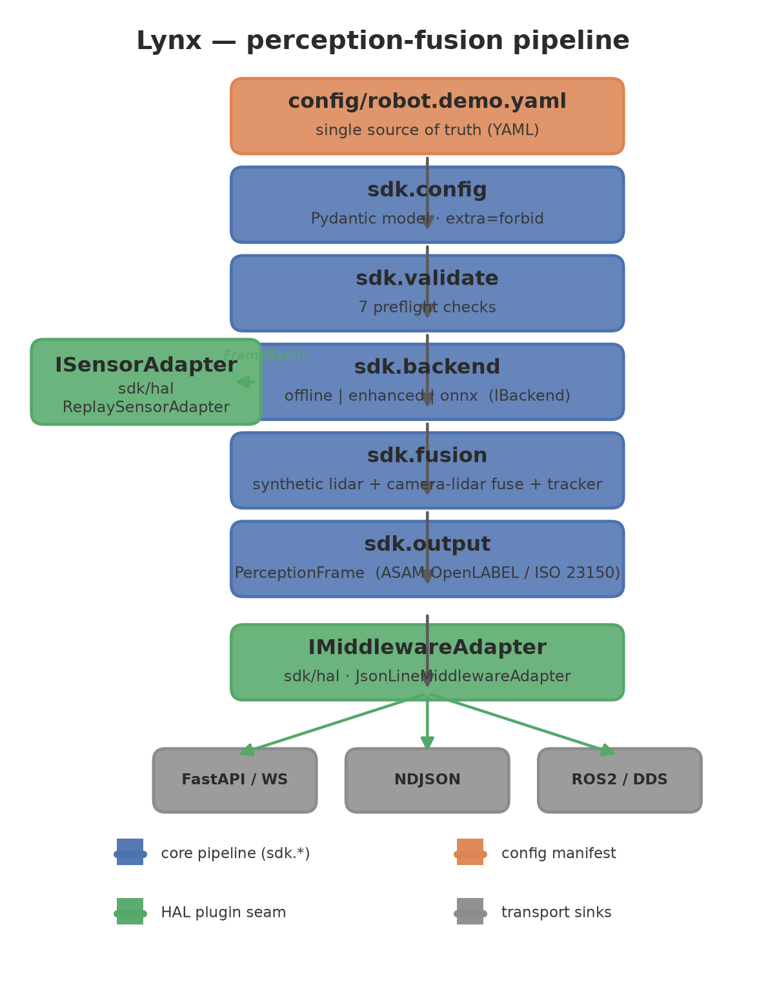
</p>

The two ends of the pipeline are plugin seams:

- `ISensorAdapter` in `sdk/hal/sensor.py` feeds time-aligned `FrameBatch` objects
  into the pipeline. The demo ships `ReplaySensorAdapter`, which plays recorded
  frames like a live camera driver.
- `IMiddlewareAdapter` in `sdk/hal/middleware.py` publishes each `PerceptionFrame`
  to any transport. The demo ships `JsonLineMiddlewareAdapter`, which writes NDJSON.

### Runtime flow

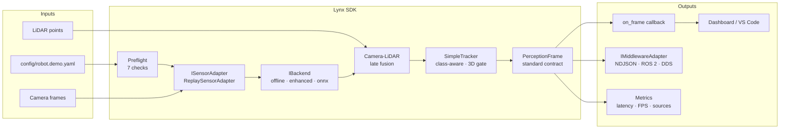

### One perception tick

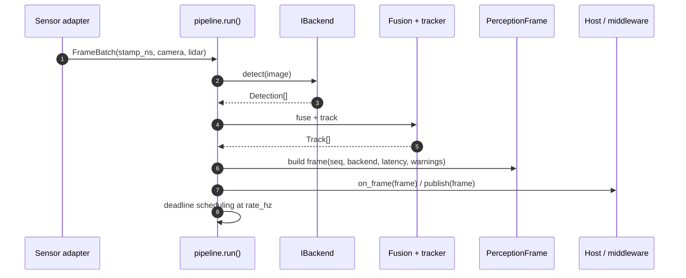

### Module dependencies

<p align="center">
  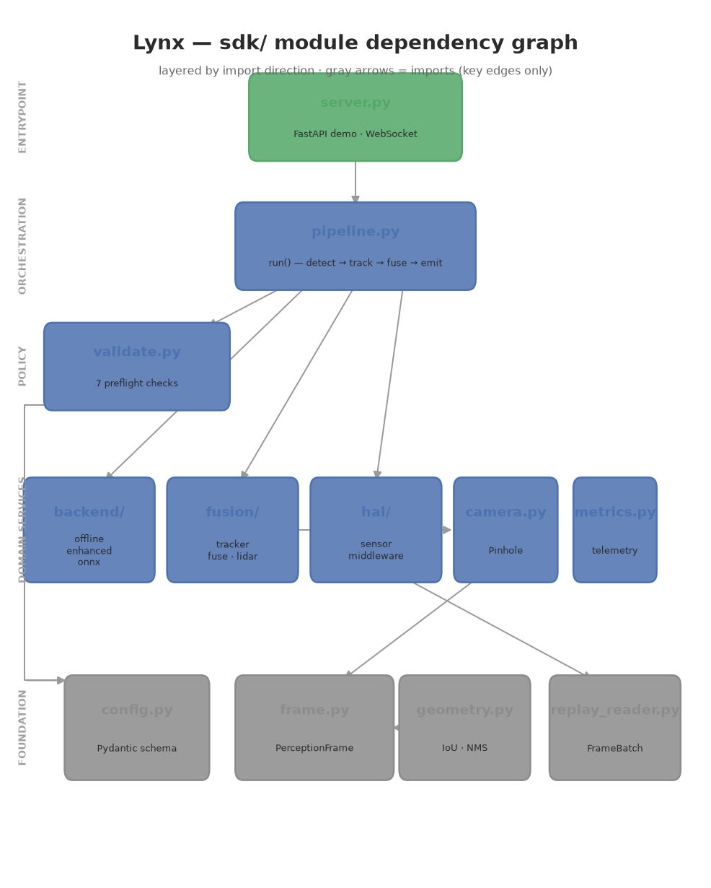
</p>

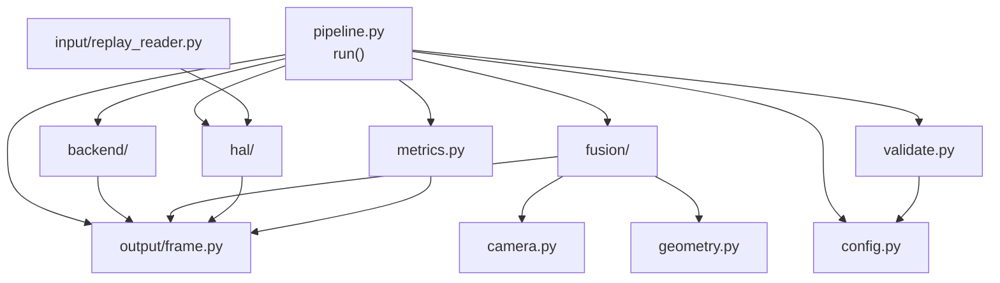

Imports fan out from `pipeline.py` (`run()`) into `backend/`, `fusion/`, and
`hal/`, while `validate.py` reads the manifest before runtime services start.
Two leaves are imported by nearly every module: `output/frame.py`, the product
contract, and `config.py`, the Pydantic schema. `input/replay_reader.py` supplies
the demo `FrameBatch` source.

A textual overview, the runtime flow, and the extension-point contract live in
[docs/architecture.md](docs/architecture.md).

### Repository layout

| Path | Responsibility |
|---|---|
| `config/robot.demo.yaml` | Single source of truth manifest |
| `sdk/config.py` | Pydantic schema, loader, path resolution |
| `sdk/validate.py` | Seven deployment preflight checks and JSON report |
| `sdk/output/frame.py` | `PerceptionFrame` and the product data model |
| `sdk/backend/` | Backend interface, offline, enhanced, ONNX, registry |
| `sdk/input/replay_reader.py` | `FrameBatch` and the replay source |
| `sdk/hal/` | Sensor and middleware seams plus demo adapters |
| `sdk/fusion/` | Tracker, camera-LiDAR late fusion, synthetic LiDAR |
| `sdk/camera.py`, `sdk/geometry.py` | Pinhole model, IoU, NMS, merge |
| `sdk/metrics.py` | In-process telemetry |
| `sdk/pipeline.py` | `run()` and deadline scheduling |
| `server.py`, `dashboard/` | FastAPI demo and single-page dashboard |
| `vscode-extension/` | Schema-driven config form and dashboard webview |
| `scripts/` | Run, smoke, benchmark, config I/O, schema and asset generation |
| `docs/` | Architecture, diagrams, generated JSON Schema, screenshots |
| `tests/` | Contract, config, pipeline, fusion, tracking, ONNX, registry tests |

## Quick start

Requires Python 3.11+. The ML backends recommend Python 3.11 or 3.12.

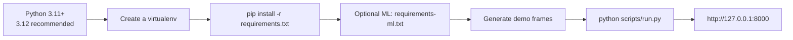

```bash
# 1. virtualenv
python3.12 -m venv .venv && source .venv/bin/activate

# 2. core dependencies: data model, config, validation, server
pip install -r requirements.txt

# 3. optional ML dependencies for real inference
pip install -r requirements-ml.txt

# 4. synthetic demo frames, no camera required
python scripts/make_demo_data.py 240 data/frames

# 5. run the demo
python scripts/run.py
# -> http://127.0.0.1:8000
```

Headless smoke test, no server and no UI:

```bash
python scripts/smoke.py config/robot.demo.yaml 5          # human-readable
python scripts/smoke.py config/robot.demo.yaml 5 --jsonl  # pure NDJSON on stdout
```

Run the full test suite:

```bash
python -m pytest tests/
ruff check sdk scripts tests server.py
mypy sdk
```

## Configuration

`config/robot.demo.yaml` is the only hand-written deployment file. Its keys map
1:1 to `sdk/config.py`, and it is the source of the JSON Schema that powers editor
IntelliSense and the VS Code config form.

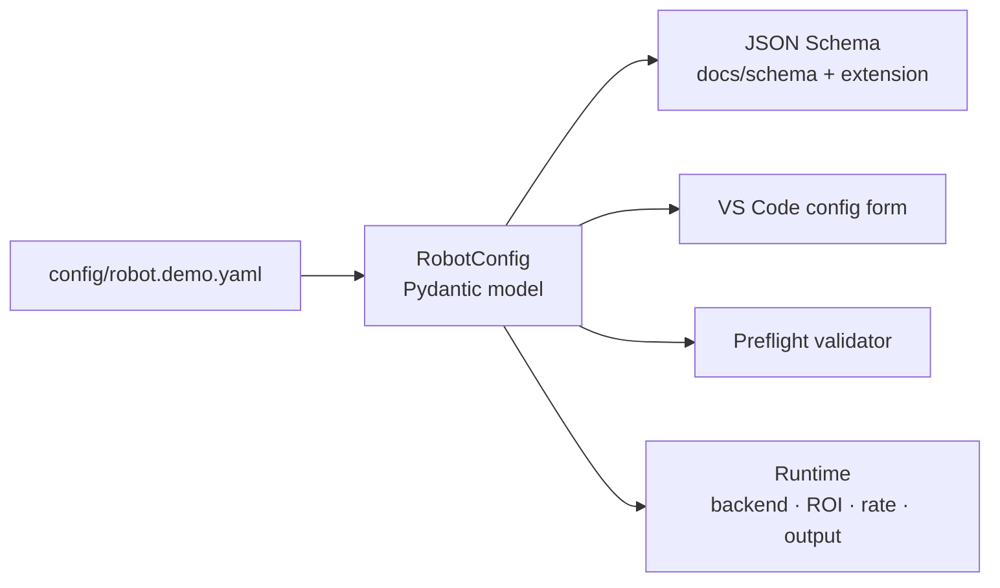

```yaml
vehicle:                    # kinematic model + envelope
  name: "demo_factory_truck"
  type: "ackermann"         # diff_drive | ackermann | skid_steer | omni
  max_speed_ms: 5.0
  wheelbase_m: 1.8
  track_width_m: 1.4
  dimensions: { l: 2.4, w: 1.3, h: 1.9 }

domain_controller:          # onboard compute target
  vendor: "nvidia"
  model: "laptop"           # laptop | jetson_orin_nano | rk3588
  compute_tops: 0
  inference_backend: "onnx_cpu"
  os: "ubuntu_22.04"
  middleware: "custom"      # ros2_humble | ros2_iron | dds_rti | some_ip | custom

sensors:                    # one entry per sensor, names must be unique
  - name: "front_cam"
    type: "camera"
    interface: "usb"        # gige | ethernet | can | usb
    topic: "cam/front"
    mount: { x: 0.0, y: 0.0, z: 1.4, roll: 0, pitch: 0, yaw: 0 }
    fps: 20
    sync_source: "software"

perception:
  backend: "offline"        # offline | enhanced | onnx
  conf: 0.4                 # 0.0 .. 1.0
  modules: [detection, tracking, traffic_sign]  # detection is required
  roi: { forward_m: 60, lateral_m: 15 }
  small_target_enhance: true

calibration:                # declared files are checked by preflight
  camera_intrinsics: null
  extrinsics: null
  lidar_camera_extrinsic: null
  time_offset_ms: {}

safety:                     # @ai-lock — read-only via tooling
  min_braking_distance_m: 1.0
  min_obstacle_height_m: 0.05
  max_detection_latency_ms: 100
  redundant_fov_required: true

data:                       # relative to this manifest in config/
  frames_dir: "../data/frames"
  index_path: "../data/index.csv"
```

| Section | Controls | Consumed by |
|---|---|---|
| `vehicle` | Kinematics, speed ceiling, envelope | Safety checks, geometry |
| `domain_controller` | Vendor, board, TOPS, execution provider, middleware | Backend selection, resource checks, middleware factory |
| `sensors` | Modality, interface, mount, rate, sync source | Preflight, adapter selection, fusion |
| `perception` | Backend, confidence, modules, ROI, small-target pass | Pipeline, backend factories |
| `output` | Frame id and loop rate | `PerceptionFrame`, deadline scheduling |
| `calibration` | Intrinsics, extrinsics, time offsets | Preflight file checks; `CalibStore` is a later milestone |
| `safety` | Braking, obstacle height, latency ceiling, redundant FOV | Preflight and per-frame warnings |
| `data` | Replay frames and index | `ReplaySensorAdapter` |

Relative paths are resolved against the directory containing the manifest, so
the SDK can be started from any working directory.

AI-annotation conventions in the manifest:

- `@ai-lock` marks read-only blocks, such as `safety`, that tooling must not
  silently rewrite.
- `@ai-extend` marks extensible custom attributes.
- `@ai-telemetry` marks fields feeding the telemetry stream.

## Data model

The product contract is `PerceptionFrame` in `sdk/output/frame.py`, exported as a
JSON Schema in `docs/schema/perception_frame.schema.json`.

<p align="center">
  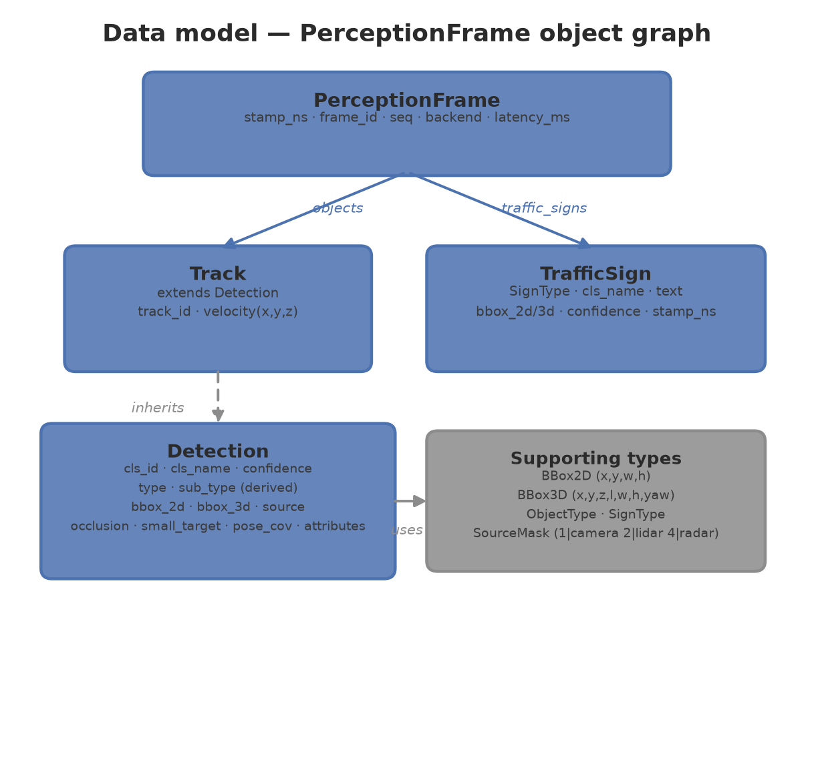
</p>

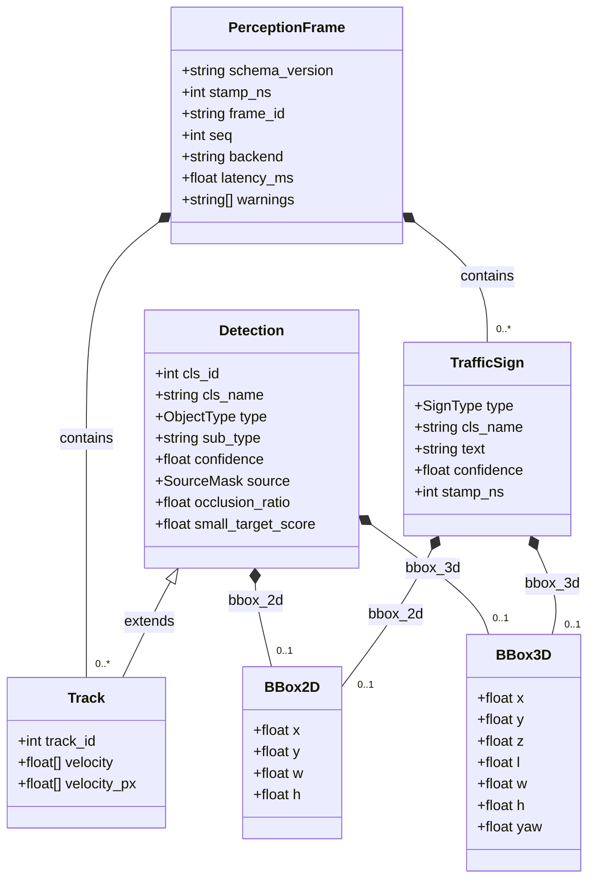

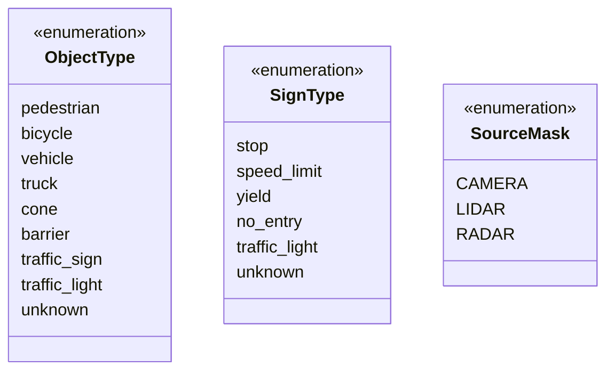

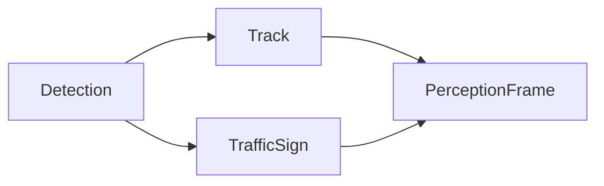

| Type | Description |
|---|---|
| `PerceptionFrame` | `schema_version`, `stamp_ns`, `frame_id`, `seq`, `backend`, `objects`, `traffic_signs`, `latency_ms`, `warnings` |
| `Track` | `Detection` plus `track_id`, 3-D `velocity` in m/s, and `velocity_px` in px/s |
| `TrafficSign` | `type`, `cls_name`, `text`, `bbox_2d/3d`, `confidence`, `stamp_ns` |
| `Detection` | `cls_id`, `cls_name`, `type`, `sub_type`, `bbox_2d/3d`, `confidence`, `source`, `occlusion_ratio`, `small_target_score`, `pose_covariance`, `attributes` |
| `BBox2D` / `BBox3D` | Image-plane `(x, y, w, h)` and vehicle-frame `(x, y, z, l, w, h, yaw)` boxes |

Enums:

- `ObjectType`: `pedestrian`, `bicycle`, `vehicle`, `truck`, `cone`, `barrier`,
  `traffic_sign`, `traffic_light`, `unknown`.
- `SignType`: `stop`, `speed_limit`, `yield`, `no_entry`, `traffic_light`,
  `unknown`.
- `SourceMask` (`IntFlag`): `CAMERA=1`, `LIDAR=2`, `RADAR=4`. Fusion is the
  bitwise OR, for example `CAMERA | LIDAR = 3`. `source_label()` renders a label.

Derived fields are filled by Pydantic validators: `type` is derived from
`cls_name`, for example `person` becomes `pedestrian`, and `sub_type` carries the
fine class. `pose_covariance` is a 6x6 row-major list, empty when unknown.
`attributes` holds `@ai-extend` custom data.

## Backends

All backends implement the same `IBackend` interface: `init`, `detect`, `info`,
and `release`. Select one with `perception.backend`.

<p align="center">
  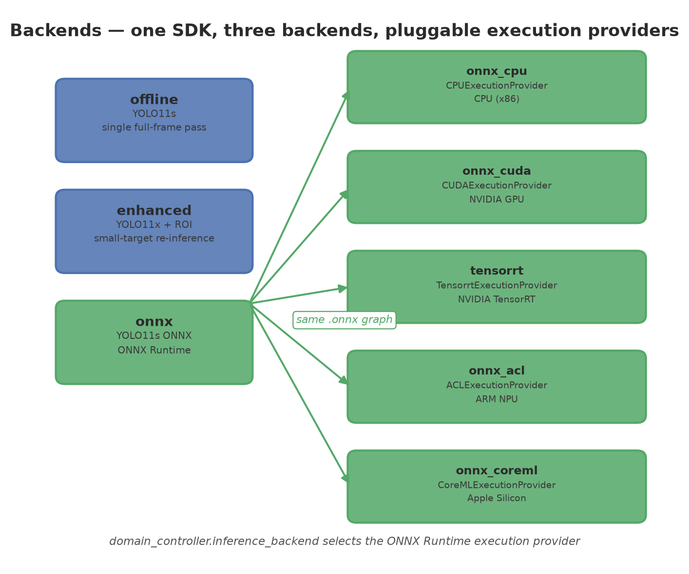
</p>

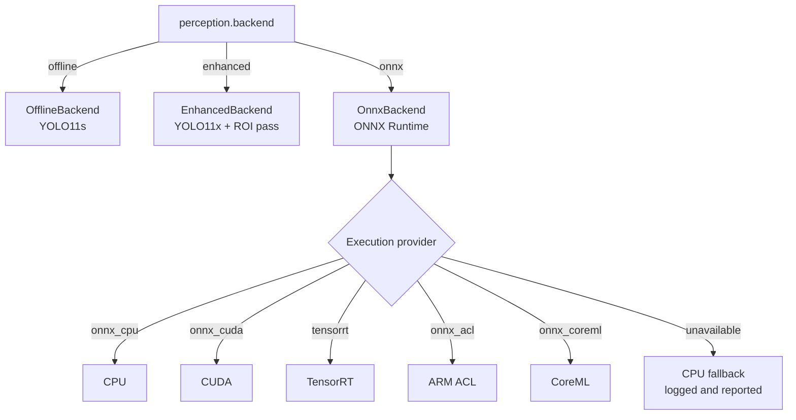

| Backend | Model | Best for | Notes |
|---|---|---|---|
| `offline` | YOLO11s | Fleet default, CPU-only controllers | Single full-frame pass, deterministic and lightweight |
| `enhanced` | YOLO11x + YOLO11s ROI | GPU or laptop validation, small distant targets | Second pass on the top image band; ROI model loads lazily |
| `onnx` | YOLO11s ONNX | Hardware portability across CPUs and accelerators | Execution provider chosen from `domain_controller.inference_backend` |

The ONNX backend is the hardware-agnostic path: the same `.onnx` graph runs on
CPU, CUDA, TensorRT, ARM ACL, or CoreML without changing the SDK code path. If
the requested provider is unavailable, the backend falls back to CPU and reports
the actual provider in `BackendInfo.extra`.

## Hardware abstraction layer

`sdk/hal/` defines the plugin seams that make the SDK hardware-agnostic.

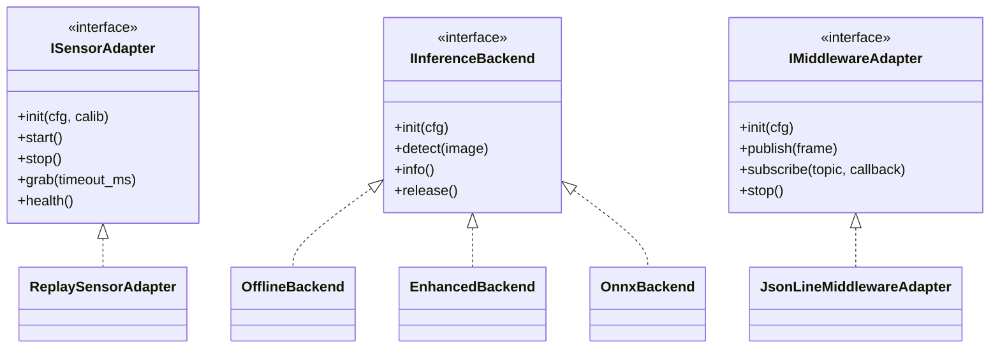

| Seam | Methods | Demo implementation |
|---|---|---|
| `ISensorAdapter` | `init`, `start`, `stop`, `grab`, `health` | `ReplaySensorAdapter` plays recorded frames in pull mode |
| `IInferenceBackend` | `init`, `detect`, `info`, `release` | Offline, enhanced, and ONNX backends |
| `IMiddlewareAdapter` | `init`, `publish`, `subscribe`, `stop` | `JsonLineMiddlewareAdapter` publishes NDJSON |

Each seam has a registry, so third-party implementations do not edit the core:

```python
from sdk.backend import register_backend

register_backend("my_backend", lambda cfg: MyBackend(cfg))
```

A production build adds one sensor adapter per physical sensor and merges their
streams into a `FrameBatch`. The demo uses a single replay adapter and synthesizes
LiDAR for the fusion path.

## Camera-LiDAR fusion

Late fusion associates camera 2D detections with LiDAR 3D boxes after projecting
the boxes through the pinhole model. Matched objects keep the camera class and
the LiDAR geometry.

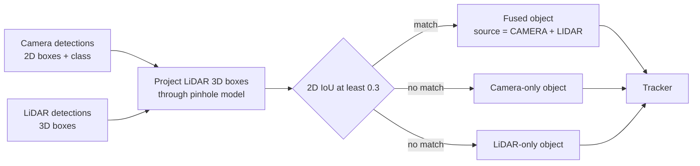

The demo ships `sdk/fusion/lidar.py`, which back-projects camera boxes into
plausible 3D boxes so the fusion path runs without a real LiDAR. The association
code in `sdk/fusion/fuse.py` is the same code a production point-cloud front-end
would feed.

## Tracking

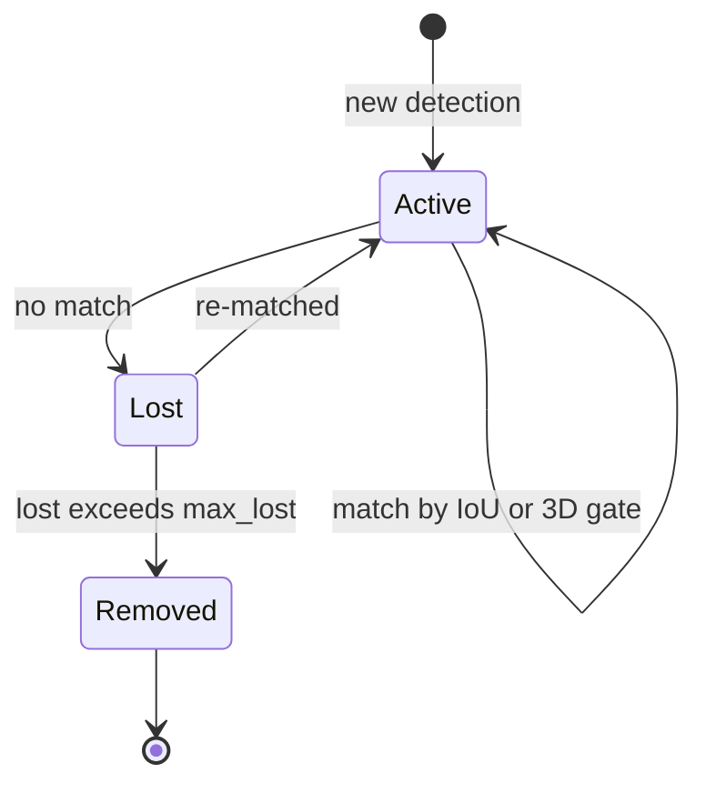

`SimpleTracker` is a legible SORT-lite tracker. It gates associations by class,
uses 2D IoU first and a 3D centre-distance gate for LiDAR-only detections, and
emits both vehicle-frame velocity in m/s and image-plane velocity in px/s. The
production upgrade path is ByteTrack or Hungarian matching with a Kalman filter.

## Validation gate

`sdk/validate.py` runs seven semantic checks before the pipeline starts.
`to_report()` renders a JSON report, and
`scripts/validate_json.py --out preflight_report.json` writes it to disk.

<p align="center">
  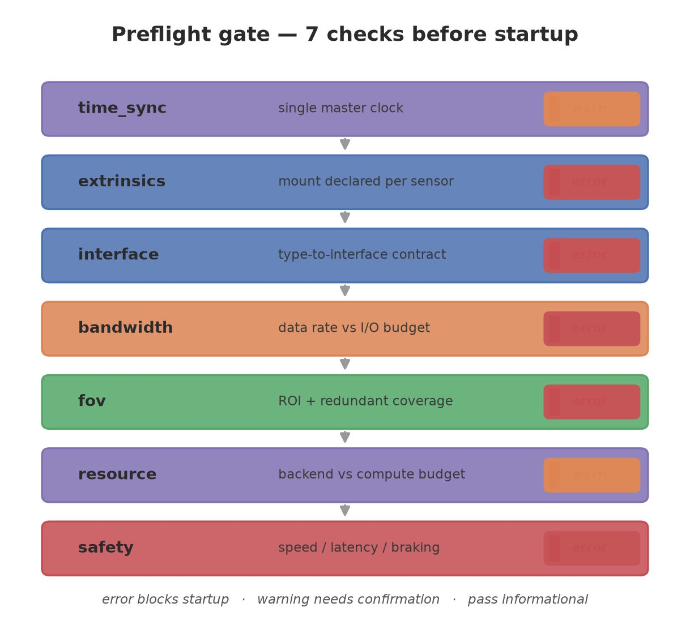
</p>

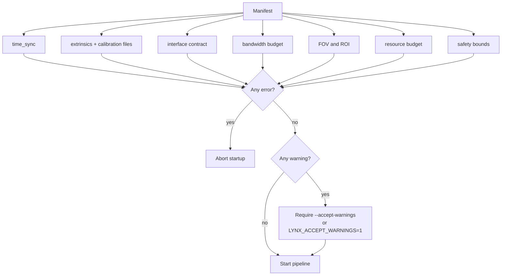

| Check | Purpose |
|---|---|
| `time_sync` | Single master clock across sensors |
| `extrinsics` | Every sensor declares a `mount`; declared calibration files exist |
| `interface` | Sensor type maps to a valid physical interface |
| `bandwidth` | Aggregate per-type data rate stays within budget |
| `fov` | ROI is positive; forward redundancy when required; at least one camera |
| `resource` | Backend and controller stay within the compute budget |
| `safety` | Speed, latency, and braking-distance bounds are positive |

Errors block startup. Warnings require an explicit opt-in:
`python scripts/run.py --accept-warnings` or `LYNX_ACCEPT_WARNINGS=1`. Runtime
latency above `safety.max_detection_latency_ms` adds
`detection_latency_exceeded` to `PerceptionFrame.warnings` and increments the
`latency_violations` metric.

## Telemetry

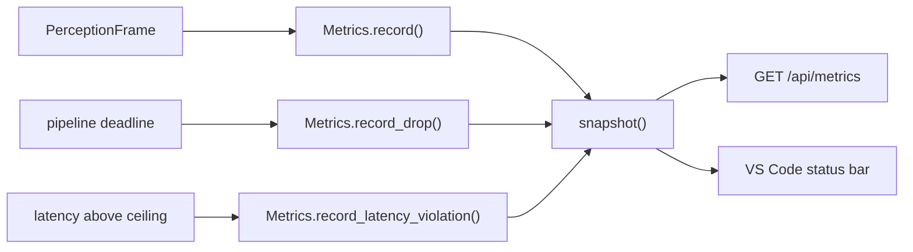

| Metric | Meaning |
|---|---|
| `frames`, `fps`, `uptime_s` | Throughput and liveness |
| `latency_ms.last/avg/p95/max` | Detection latency, nearest-rank percentiles |
| `objects.last`, `objects.sources` | Object count by camera, LiDAR, radar, or fusion |
| `dropped_frames` | Deadlines missed by more than one period |
| `latency_violations` | Frames above `safety.max_detection_latency_ms` |

## Demo server

`server.py` exposes a FastAPI application. The pipeline runs in a daemon thread,
and a separate broadcaster thread annotates and JPEG-encodes frames only when a
viewer is connected.

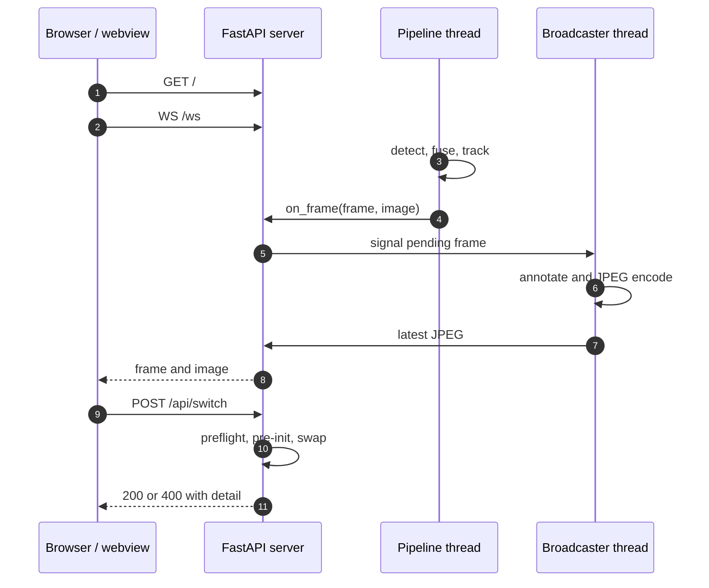

| Endpoint | Description |
|---|---|
| `GET /` | Single-page dashboard |
| `WS /ws` | Streams `{ frame, image }`; image is base64 JPEG |
| `GET /api/state` | Backend, liveness, last error, latency ceiling |
| `GET /api/metrics` | Runtime telemetry |
| `POST /api/switch` | Switch `offline`, `enhanced`, or `onnx` at runtime |

Backend switching pre-initializes the new backend before stopping the old one.
If initialization fails, the old pipeline keeps running and the endpoint returns
HTTP 400 with the reason. The server enables CORS for local webviews so the
VS Code dashboard can call `/api/switch`.

## VS Code extension

<p align="center">
  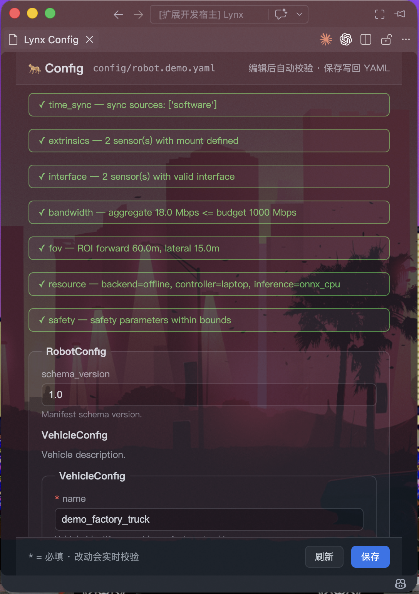
  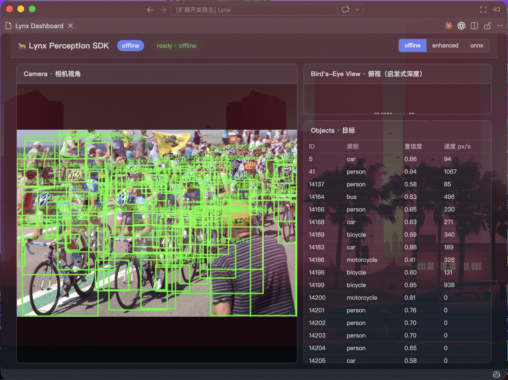
</p>

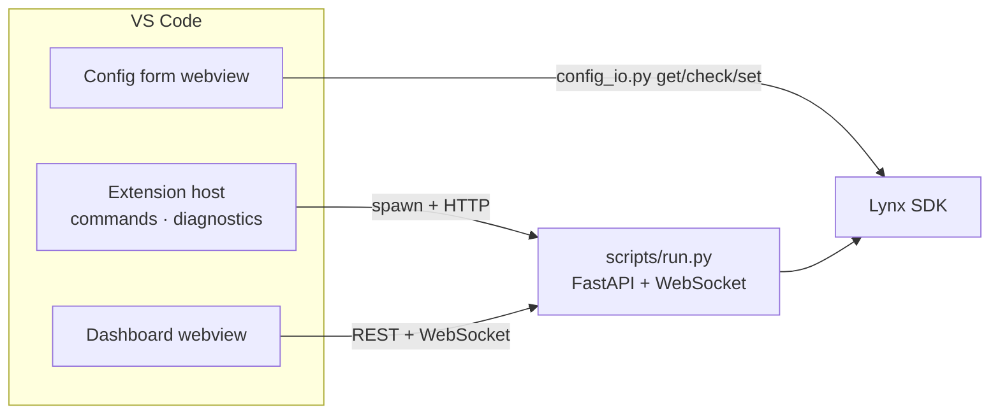

| Feature | Command | Detail |
|---|---|---|
| Dashboard | `Lynx: Show Dashboard` | Camera overlay, bird's-eye view, objects |
| Start / stop | `Lynx: Start Demo` / `Lynx: Stop` | Spawns or kills `scripts/run.py` on a free port |
| Backend switch | `Lynx: Switch Backend` | QuickPick over offline, enhanced, onnx |
| Config form | `Lynx: Edit Config (Form)` | Schema-driven form with live preflight checks |
| Validation | `Lynx: Validate Config` | Runs `validate_json.py` and maps results to diagnostics |

## Development

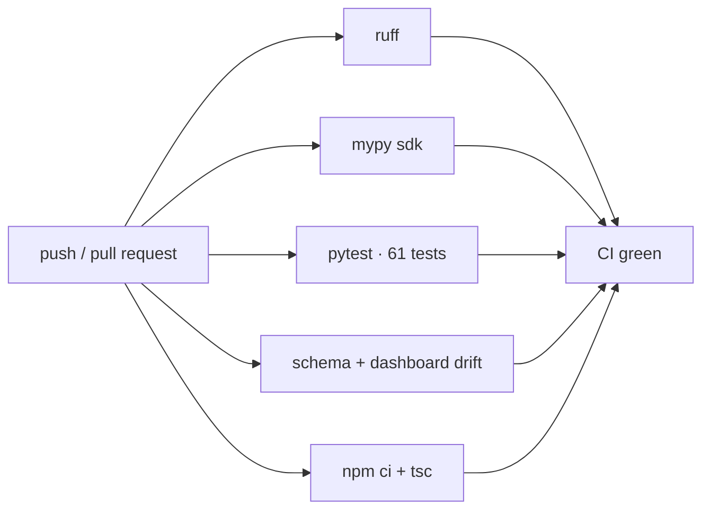

```bash
python scripts/export_schema.py docs/schema    # regenerate JSON Schema + extension copy
python scripts/export_schema.py --check        # CI drift guard
python scripts/sync_dashboard.py               # regenerate the webview dashboard
python scripts/sync_dashboard.py --check       # CI drift guard
python scripts/validate_json.py config/robot.demo.yaml --out preflight_report.json
python scripts/config_io.py get config/robot.demo.yaml       # config -> JSON
python scripts/config_io.py set config/robot.demo.yaml       # JSON -> config on stdin
python -m pytest tests/
ruff check sdk scripts tests server.py
mypy sdk
```

| Test area | What it proves |
|---|---|
| `test_frame`, `test_contract` | Output schema, derived fields, versioning, serialization |
| `test_config`, `test_config_io` | Bounds, uniqueness, path resolution, comment-preserving atomic writes |
| `test_pipeline` | Vertical slice, stderr logging, preflight opt-in, latency flags, module gates |
| `test_fusion`, `test_geometry` | Projection, association, class-aware NMS and merge |
| `test_tracker` | Id persistence, class gating, 2D/3D velocity |
| `test_onnx_decode` | Both ONNX output layouts and letterbox mapping |
| `test_replay_reader`, `test_registry` | Replay source and plugin registries |

The SDK is installable as `pip install -e .` with extras `.[ml]`, `.[server]`,
and `.[dev]`. `pyproject.toml` is the single packaging source. Commit messages
follow Conventional Commits and are written in English.

## Roadmap

| Milestone | Status | Scope |
|---|---|---|
| Walking skeleton | ✅ Done | End-to-end pipeline, demo server, dashboard, VS Code shell |
| Hardened runtime | 🚧 In progress | Safe backend swap, broadcaster, deadline scheduling, drift guards |
| Real multi-sensor input | Planned | One adapter per sensor and `FrameBatch` stream merging |
| Calibration store | Planned | Intrinsics, extrinsics, and time-offset loading |
| Transport adapters | Planned | ROS 2, DDS, and SOME/IP middleware implementations |
| Production tracking | Planned | ByteTrack or Hungarian matching with Kalman filtering |
| Deployment tooling | Planned | Measured compute budgets, model packaging, device profiles |

## Documentation

| Document | Contents |
|---|---|
| [docs/architecture.md](docs/architecture.md) | Runtime flow, layers, extension points, milestones |
| [docs/schema/robot_config.schema.json](docs/schema/robot_config.schema.json) | Generated config JSON Schema |
| [docs/schema/perception_frame.schema.json](docs/schema/perception_frame.schema.json) | Generated output JSON Schema |
| [docs/architecture.png](docs/architecture.png) | Architecture overview |
| [docs/dependencies.png](docs/dependencies.png) | Module dependency graph |
| [docs/datamodel.png](docs/datamodel.png) | Data model overview |
| [docs/backends.png](docs/backends.png) | Backends and execution providers |
| [docs/validation.png](docs/validation.png) | Validation gate |
| [README.zh-CN.md](README.zh-CN.md) | Simplified Chinese translation |
| [README.fr.md](README.fr.md) | French translation |

## License

Apache-2.0. See [LICENSE](LICENSE).
