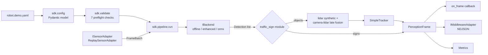

# Lynx architecture

Lynx is a perception-fusion SDK for low-speed autonomous vehicles in enclosed
sites. The repository is a walking skeleton: every layer of the product is
present and executable, with demo implementations behind production-shaped
interfaces.

## Runtime flow

`run()` is the vertical slice. It validates the manifest, constructs the
selected backend and the configured sensor adapter, then loops over
time-aligned frames. Each frame is detected, optionally fused with LiDAR,
tracked, packed into `PerceptionFrame`, and delivered to the host callback,
the middleware adapter, and the metrics collector.

## Layers

| Layer | Files | Responsibility |
|---|---|---|
| Contract | `sdk/output/frame.py` | `PerceptionFrame`, `Detection`, `Track`, `TrafficSign`, enums, JSON Schema source |
| Configuration | `sdk/config.py` | Manifest model, bounds, uniqueness checks, manifest-relative path resolution |
| Preflight | `sdk/validate.py` | Time sync, extrinsics/calibration, interface, bandwidth, FOV, resource, safety |
| Plugin seams | `sdk/hal/` | `ISensorAdapter`, `IInferenceBackend`, `IMiddlewareAdapter` and their registries |
| Backends | `sdk/backend/` | Offline YOLO11s, enhanced YOLO11x + ROI, ONNX Runtime with execution providers |
| Fusion | `sdk/fusion/` | SORT-lite tracker, synthetic LiDAR, camera-LiDAR late fusion |
| Geometry | `sdk/geometry.py`, `sdk/camera.py` | NMS/merge, pinhole projection, depth heuristic |
| Telemetry | `sdk/metrics.py` | Latency percentiles, throughput, source counts, drops, violations |
| Hosts | `server.py`, `dashboard/`, `vscode-extension/` | FastAPI demo, web dashboard, VS Code shell |

## Extension points

- **Backend**: call `sdk.backend.register_backend(name, factory)` from an import
  path that runs before the pipeline. The factory receives the validated
  `RobotConfig` and returns an initialized-on-demand `IBackend`.
- **Sensor**: call `sdk.hal.sensor.register_sensor_adapter(name, factory)`.
  `build_sensor_adapter` initializes the adapter and returns it. The demo
  registers `replay`; production drivers add one adapter per sensor and merge
  streams into `FrameBatch`.
- **Middleware**: call `sdk.hal.middleware.register_middleware(name, factory)`.
  The demo registers `custom` for NDJSON. ROS 2, DDS, and SOME/IP adapters use
  the same seam.

## Configuration as the single source of truth

`sdk/config.py` drives four artifacts:

1. Structural validation with `extra="forbid"` and field bounds.
2. Semantic preflight checks in `sdk/validate.py`.
3. JSON Schema exported to `docs/schema/` and the VS Code extension.
4. Runtime behavior in `sdk/pipeline.py` and the backend factories.

Relative paths such as `data.frames_dir` are resolved against the directory
containing the manifest. `scripts/export_schema.py --check` and
`scripts/sync_dashboard.py --check` guard generated artifacts in CI.

## Milestones not yet implemented

- `CalibStore` loading and per-sensor calibration threading.
- ROS 2 / DDS / SOME/IP middleware adapters.
- Real multi-sensor `FrameBatch` merging and point-cloud clustering.
- Production tracker, planner-facing safety enforcement, and measured
  resource budgets.
